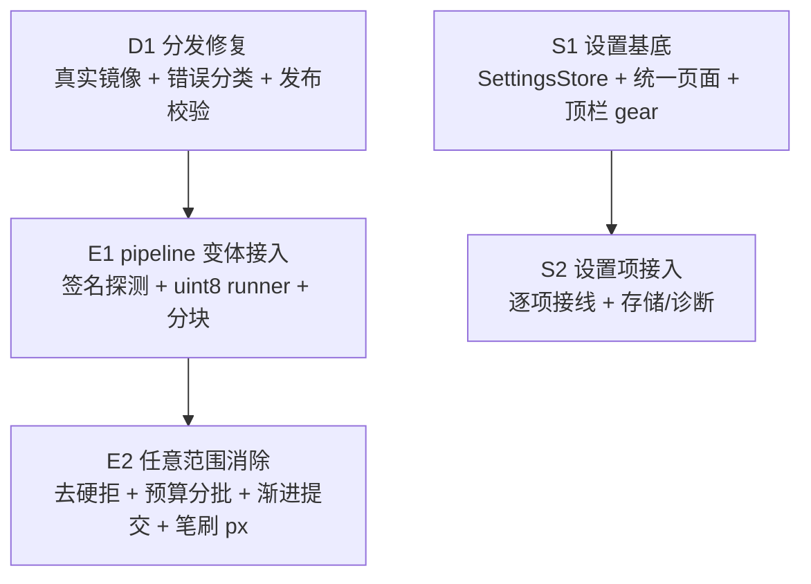

# PhotoSync AI 工具可用性、任意范围消除与统一设置页规范

- **状态**：待实现（本文件只做规格锁定，不含代码变更）
- **日期**：2026-11-27
- **上位规范**：[端侧与可选云端 AI 工具（P0–P4）完整技术规范](../ai-tools/spec.md)（本规范不推翻其非破坏性、合规与隐私底线，只修正分发、消除交互与设置组织）
- **前序工单**：[P0 统一端侧 AI 底座](../ai-tools/issues/01-p0-ort-runtime-model-manager-and-device-gate.md)、[P2 智能消除](../ai-tools/issues/06-p2-inpaint-migan-brush-and-patch-layer.md)
- **代号**：`W-UX`（三个并行目标：`W-UX/D` 分发、`W-UX/E` 消除、`W-UX/S` 设置）

---

## 1. Problem Statement

P0–P4 已按规格落地，但真实使用路径上有三处硬阻塞：

1. **AI 模型下载在实际网络下必然失败，且失败原因被误报为"网络问题"。**
   `AiModelCatalog` 的两个模型主源都指向不存在的 GitHub Release 资产，MODNet 靠 HuggingFace 兜底侥幸可用，MI-GAN 只有一条 GitHub 镜像因而必定失败；失败被归入 `DOWNLOAD_FAILED`，界面提示"所有镜像均不可用，请检查网络后重试"，用户按提示反复重试只会继续失败。

2. **涂抹消除的可用阈值与真实能力相差一个数量级，"涂一丢丢就超限"。**
   一笔就触发琥珀色"请分次涂抹"建议（阈值 256 px），而实际规划器允许 2048 px 边长 / 256 tile；继续涂抹则会直接抛 `InpaintPlanTooLargeException` 并以"消除范围过大"结束，不产生任何修复。用户被迫反复小块涂抹，且取消一次运行会丢弃全部已完成的修复结果。

3. **设置入口碎片化，用户无法在一个地方找到可调配项。**
   顶栏只有一个"AI 模型"图标，点进去是模型列表，内部再跳"云设置"；其余可调配项（自动跳转、相机删除联动、屏幕常亮、预览分辨率、导出质量、撤销深度、推理线程、会话闲置、设备档位、存储占用）要么根本不存在，要么写死在代码常量或布局属性里，用户无从调整。

---

## 2. Verified Facts（2026-11-27 本机实测，Linux x86_64 / ONNX Runtime 1.32.0 / CPU 2 线程）

> 桌面 x86 数据只用于判定**相对行为**（掩码语义、恒等性、裁切半径敏感性、内存量级与线性度）。
> 真机耗时为另一道门禁，见 §11。此处不把桌面毫秒数当作移动端性能结论。

### 2.1 现有分发链路失败事实

| 检查 | 结果 |
|---|---|
| `gh release list` 是否存在 `ai-models-v1` | **不存在**（线上只有 `v0.3.1…v0.1.1`） |
| `releases/download/ai-models-v1/modnet_photographic_portrait_matting.onnx` | HTTP **404** |
| `releases/download/ai-models-v1/migan_generator_512.onnx` | HTTP **404** |
| `huggingface.co/Xenova/modnet`（`onnx/model.onnx`） | 200，25,888,640 B，SHA-256 `07c308cf…84df9`，`accept-ranges: bytes` |
| `hf-mirror.com/Xenova/modnet`（同文件） | 字节一致，SHA-256 相同 |
| `AiModelDownloadManager` 对 404 的分类 | `DOWNLOAD_FAILED`（用户可见文案为"网络问题"） |
| `AiModelSettingsActivity.startDownload` 行为 | 已安装时**先删除再重下**，无二次确认；下载中只能禁用按钮，无取消 |

结论：MODNet 可用是**兜底的偶然**，MI-GAN 在设计上就没有可用分发路径；文案把"源不存在"误报成"网络不可用"，导致用户无法自救。

### 2.2 候选 MI-GAN pipeline 实测（三源字节一致）

| 源 | 大小 | SHA-256 | 许可元数据 |
|---|---|---|---|
| `huggingface.co/andraniksargsyan/migan/resolve/main/migan_pipeline_v2.onnx` | 28,079,181 B | `6f1f3530a1a2324b19752018ce756088b07973cda8d7d890034ace5c8a48c40b` | `license: mit` |
| `hf-mirror.com/andraniksargsyan/migan/…`（同文件） | 同 | 同 | — |
| `huggingface.co/anyisalin/migan-onnx/resolve/main/onnx/model.onnx` | 同 | 同 | 无 `license` 字段（仅 tags） |

ONNX 签名（`onnx.load`）：

| 项 | 值 |
|---|---|
| 输入 | `image` `tensor(uint8)` `[batch,3,H,W]`；`mask` `tensor(uint8)` `[batch,1,H,W]`（**H/W 动态**） |
| 输出 | `result` `tensor(uint8)` `[batch,3,H,W]` |
| 掩码语义 | **255 = 保留，0 = 待修复**（与当前 Kotlin `InpaintMaskBuffer` 的 255=hole **相反**） |
| 节点数 | 1218；含 `Resize`×17、`NonZero`×2、`ScatterND`×1、`GatherND`×2、`Range`×6、`Where`×4（内部自带裁切/缩放/回贴，无法静态折叠） |
| 支持尺寸 | 512²、256²、64²、777×513、1024²、2048×640、2048²、3072×2048、4096²、6000×4000、贴边洞 400²：全部成功 |

行为实测：

| 用例 | 结果 |
|---|---|
| 无洞（掩码全 255） | 输出与原图 **maxdiff = 0**（严格恒等，不会无故改图） |
| 软掩码 0/64/128/192 | 洞内平均改动 39.3 / 22.3 / 13.5 / 5.5 → **原生支持半透明掩码**（自带渐变羽化） |
| 通道序 | 输入 R,G,B = 200,40,10 → 洞外输出通道均值 200,40,10（**RGB，非 BGR**） |
| 耗时（桌面） | 512²→6000×4000 全部 0.70–1.21 s（内部统一降到 512 推理，成本近常数） |
| 峰值 RSS（关 cpu-mem-arena + memory-pattern） | 512² **413 MB**、1024² 414 MB、1536² 422 MB、2048² 434 MB、4096² 941 MB、6000×4000 1,247 MB（基线 116 MB） |
| 峰值 RSS（默认 arena/pattern 开启） | 512² 479 MB、2048² 1,080 MB、4096² 1,680 MB、6000×4000 2,095 MB |

要点：**内存随输入边长增长**（内部要把整幅图像搬进去再降采样），因此仍必须限制单次输入边长；关闭 arena/pattern 后 2048² 以内的增量可控（≈+320 MB）。

### 2.3 裁切半径与细节保真（决定"要不要分块"的关键实测）

同一幅 4 px 棋盘测试图、128×128 洞，只改变喂给模型的裁切边长：

| 裁切 | 洞内 std（原图 110） | 洞外 maxdiff |
|---|---|---|
| 192²（边距 32） | 57 | 11 |
| 256²（边距 64） | 53 | 10 |
| 320²（边距 96） | 70 | 14 |
| **384²（边距 128）** | **81（最佳）** | 14 |
| 512²（边距 192） | 75 | 10 |
| 640²（边距 256） | 75 | — |
| 1600²（整幅） | 明显糊化 | — |

结论：

1. **上下文边距 ≈128 px、单次裁切 384–640 px 时细节最佳**（与上游 pipeline 自身默认一致），裁切越大越糊，因为模型内部固定 512 推理；
2. 洞外仍会有 ≤14 级的轻微改动，**必须保留 Kotlin 侧的 alpha 合成兜住洞外像素**（当前 `InpaintComponentBlend` 的 alpha=0 语义正好满足）；
3. 贴边洞可用，不需要额外补边。

### 2.4 消除可用性阈值错配事实

| 项 | 现值 | 真实能力 | 结论 |
|---|---|---|---|
| 琥珀色建议阈值 | `INPAINT_OVERSIZE_LIMIT_PX = 256` | 规划器 `MAX_PATCH_PIXELS = 2048²`、`MAX_TILES_PER_COMPONENT = 256` | 阈值低 8 倍，属纯噪音 |
| 默认笔刷直径 | `DEFAULT_RADIUS = 0.02f`（源宽的 4%） | — | 6000 px 宽照片上一笔 **240 px**，一笔即触发告警 |
| 硬拒条件 | patch 边长 > 2048 或 tile > 256 → `InpaintPlanTooLargeException` | 24 MP 的 30% 边长 | 用户的第一反应是"再涂大一点"，于是必失败 |
| 取消语义 | `EditorInpaintController` 仅在整体成功时提交 graph | 逐组件已落盘但未提交 | 取消 = 全部白做 |
| 笔刷单位 | 源宽百分比 | — | 用户看不到 px，无法判断"会不会超限" |

### 2.5 设置项散落清单（现状盘点）

已在 `SharedPreferences` 持久化（分散在 5 个文件）：

| 键 | 文件 | 现状入口 |
|---|---|---|
| `delete_on_camera` | `photosync_prefs` | 删除对话框勾选框 |
| `pref_live_tether_preset_id` | `photosync_editor_prefs` | 编辑器预设条 / 暗房 |
| `gpu_blacklisted` | `mediapipe_delegate` | 无 UI（自动降级结果） |
| `cloud_enabled`、`profiles`、`active_profile_id` | `photosync_cloud_providers` | 云设置页 |
| 知情同意 | `photosync_cloud_consent` | 首次云端告知 |

**未持久化**（内存变量，重启丢失）：

| 项 | 位置 |
|---|---|
| 新照片自动跳转（`autoFollowEnabled = true`） | `MainActivity.kt:141` |

**写死在代码常量或布局里**（用户不可调）：

| 项 | 现值 | 位置 |
|---|---|---|
| 导出 JPEG 质量 | 95 | `JpegScanlineContract.DEFAULT_QUALITY` |
| 预览缓存 JPEG 质量 | 92 | `OffscreenPreviewChain` / `PreviewCacheWriter` / `SkyImportPipeline` |
| 编辑器预览长边 | 2048 | `EditorBitmapLoader.EDITOR_PREVIEW_MAX_EDGE_PX` |
| 拖动代理长边 | 1024 | `EditorBitmapLoader.PROXY_MAX_EDGE_PX` |
| RAW 线性预览长边 | 2048 / 1024 | `EditorSource.LINEAR_PREVIEW_MAX_EDGE_PX` / `LINEAR_PROXY_MAX_EDGE_PX` |
| 天空预览长边 | 1024 | `EditorPreviewSession.SKY_PREVIEW_MAX_EDGE_PX` |
| 云端层预览长边 | 2048 | `EditorPreviewSession.CLOUD_PREVIEW_MAX_EDGE_PX` |
| 撤销深度 | 50 | `EditorUndoController.DEFAULT_MAX_UNDO_DEPTH` |
| 撤销合并窗口 | 300 ms | `EditorUndoController.DEFAULT_COALESCE_WINDOW_MS` |
| ORT 线程数 | 2 | `OnnxRuntimeSessionFactory.DEFAULT_INTRA_OP_THREADS` |
| 会话闲置释放 | 30 s | `OrtSessionManager.STANDARD_IDLE_TIMEOUT_MS` |
| 低端档判定 | ≤4 GiB 自动 | `DeviceMemoryTier.LOW_TIER_MAX_TOTAL_MEMORY_BYTES` |
| 消除笔刷默认/上下限 | 0.02 / 0.004–0.08 | `InpaintPanelView.DEFAULT_RADIUS` 等 |
| LUT 内存缓存容量 | 8 | `CubeLutStore.MEMORY_CACHE_CAPACITY` |
| 人像分析缓存条数 | 4 | `PortraitAnalysisCache.DEFAULT_MAX_ENTRIES` |
| 天空素材长边/上限 | 4096 px / 32 MB | `SkyCustomAssetStore.MAX_EDGE_PX` / `MAX_BYTES` |
| 云端上传长边 / 质量 / 响应上限 | 2048 / 90 / 32 MiB | `CloudUploadSanitizer` / `CloudNetworkPolicy` |
| 屏幕常亮 | 恒 `true` | `activity_main.xml`、`activity_editor.xml` |

存储占用分散在 4 个目录，无任何 UI 可见：`filesDir/models`（模型）、`filesDir/edits`（AI 资产 + 液化网格）、`filesDir/skies`、`filesDir/luts`、`cacheDir/edits`（预览缓存）。

---

## 3. Solution 概览

三个目标互不阻塞，`W-UX/D` 与 `W-UX/E` 串行（先能下、再能跑、再好用），`W-UX/S` 独立可并行。

**不改变的既有契约**（本规范全程遵守）：

- 原始 RAW/JPEG 永不改写；AI 产物仍是 `EditGraph` v2 的内容寻址外置资产；
- `InpaintPatch` 仍挂载于 Pre-Pass A 原图空间、支持全分辨率烘焙与逐次撤销；
- 云端仍默认关闭、纯 BYOK、外发强制剥离 EXIF；
- 不新增运行时依赖（继续使用 `onnxruntime-android:1.22.0` 与既有 `HttpURLConnection`）。

---

## 4. 领域词汇增量

| 术语 | 定义 | 避免混用 |
|---|---|---|
| **MirrorSource（镜像源）** | 一个可提供**字节与摘要可校验**模型文件的具体 URL；只有通过 size + SHA-256 双校验后才算"可用源"。 | 备用下载、任意链接 |
| **SourceGone（源已下线）** | 镜像返回 404/410 等永久性缺失状态；与网络故障区分，用户动作是"换镜像或本地导入"，不是"重试"。 | 网络错误、下载失败 |
| **InpaintVariant（消除模型变体）** | 由 ONNX 输入签名决定的执行形态：`GENERATOR_FIXED_512`（float32 `[1,4,512,512]`）或 `PIPELINE_UINT8`（uint8 动态 `image`+`mask`）。 | 模型版本、模型格式 |
| **PaintBudget（涂抹预算）** | 由设备档位推导的单次运行上限（裁切边长与批内 tile 数），超过即自动分批，永不作为拒绝理由。 | 涂抹上限、大小限制 |
| **ProgressiveCommit（渐进提交）** | 每完成一批即写入 `EditGraph.inpaint` 并生成一次撤销事务；取消时保留已完成部分。 | 增量保存、自动保存 |
| **SettingsGroup（设置分组）** | 统一设置页的一级分区，按"用户想找什么"划分，不按代码模块划分。 | 设置分类、标签页 |

---

## 5. D1 — 模型分发修复

### 5.1 Catalog 调整

| 模型 | 新 pin | 镜像顺序 |
|---|---|---|
| MODNet 人像抠图 | 不变：25,888,640 B / `07c308cf0fc7e6e8b2065a12ed7fc07e1de8febb7dc7839d7b7f15dd66584df9` | **移除 404 的 GitHub 主源**：`huggingface.co/Xenova/modnet` → `hf-mirror.com/Xenova/modnet` |
| MI-GAN 智能消除 | **更换**为 `migan_pipeline_512_v1.onnx`：28,079,181 B / `6f1f3530a1a2324b19752018ce756088b07973cda8d7d890034ace5c8a48c40b` | `huggingface.co/andraniksargsyan/migan` → `hf-mirror.com/andraniksargsyan/migan` → `huggingface.co/anyisalin/migan-onnx`（字节相同，作第三兜底） |

- 旧 pin（28,026,303 B / `522048b4…`）**不删除**：保留为 `MI_GAN_GENERATOR_LEGACY` 只读条目，供变体探测与本地导入识别；不再出现在下载按钮上。
- `AiModelSpec` 新增 `variantHint: InpaintVariant?`（仅消除模型使用），用于在下载完成前后给出可读状态，实际判据仍是运行时签名探测（§6.1）。

### 5.2 镜像可用性不能靠"列表非空"

- 设置页与首次安装弹窗展示的模型状态必须源于**最近一次真实探测结果**，而不是 `isPinned`：
  - 未探测 → `未安装`（可下载）；
  - 探测全部失败且最近失败原因为 `SOURCE_GONE` → 状态显示 `源已下线`，主按钮改为 `本地导入`，下载按钮保留但标注"可能不可用"。
- 探测只在用户显式触发下载时发生，不做后台轮询（沿用零预热红线）。

### 5.3 失败原因细分

`AiModelFailureReason` 扩充并与动作绑定：

| 原因 | 触发 | 用户文案 | 提供动作 |
|---|---|---|---|
| `NOT_AVAILABLE` | 目录未固化 | 该模型尚未发布 | 无 |
| `SOURCE_GONE` | 所有镜像 404/410 | 模型源已下线，可能已迁移 | 换镜像 / 本地导入 |
| `SOURCE_DENIED` | 401/403 | 模型源拒绝访问 | 换镜像 / 本地导入 |
| `TRANSPORT` | 超时、连接重置、无网络 | 传输中断，已保留断点 | 继续下载 |
| `SIZE_MISMATCH` | 字节数不符 | 文件不完整或被截断 | 重新下载 |
| `CHECKSUM_MISMATCH` | SHA-256 不符 | 文件校验失败，可能被篡改 | 重新下载 / 本地导入 |
| `INCOMPATIBLE` | 签名不匹配任何变体 | 模型格式与当前版本不匹配 | 本地导入（换成正确文件） |
| `STORAGE_FAILURE` | 目录不可写 | 存储空间不足或目录不可写 | 清理存储后再试 |

`HttpUrlConnectionSource` 需把 `responseCode` 传回上层（当前 404 被折叠成 `IOException`，信息已丢失）。

### 5.4 下载交互修正

- 下载中提供**取消**（保留 `.part`，状态转 `TRANSPORT`/暂停，可继续）。
- "重新下载"改为二次确认；**未确认前不删除已安装文件**（当前实现是直接 delete 再下）。
- 下载进度显示"已下载 / 总大小"与百分比，而不是只有百分比。
- 编辑器内首次安装弹窗（`AiModelPromptDialog`）与设置页共用同一状态机与同一套失败文案，不允许两套措辞。

### 5.5 发布护栏

新增 `tools/verify-ai-model-catalog.sh`：

1. 遍历 `AiModelCatalog` 全部 `mirrorUrls`（脚本内置与 Kotlin 目录一致的 URL/size/sha 清单，由 `AiModelCatalogTest` 校验两侧同步）；
2. 每个 URL 做 `HEAD` + `Range: bytes=0-65535` 探针，要求 2xx 且支持 Range；
3. 对至少一个源完整下载并比对 size 与 SHA-256；
4. 任一 pin 的全部源都不可达 → 退出码非 0。

CI 增加 `catalog` job（仅跑该脚本，网络失败视为失败），防止"pin 指向空 release"重演。

---

## 6. E1 — MI-GAN pipeline 变体接入

### 6.1 变体探测（一次探测，随模型缓存）

创建/首次使用时读取 `OrtSession.getInputInfo()`：

| 判据 | 变体 |
|---|---|
| 输入集合 = `{input}` 且类型 `FLOAT`、形状 `[1,4,512,512]` | `GENERATOR_FIXED_512` |
| 输入集合 = `{image, mask}` 且均为 `UINT8`、维度 4 且 H/W 为动态维度 | `PIPELINE_UINT8` |
| 其他 | 拒绝，`INCOMPATIBLE` |

- 探测结果与 `(fileLength, sha256)` 一起缓存在模型目录旁的元数据（不重算哈希，哈希已在安装时验证过）。
- 两种变体都保留实现：`GENERATOR_FIXED_512` 用现有 `OnnxMiGanTileRunner`；`PIPELINE_UINT8` 用新增 `MiganPipelineRunner`。这样用户本地导入旧 generator 文件同样能用。

### 6.2 掩码语义适配（最易错点）

| 环节 | 现实现 | 新 pipeline 路径 |
|---|---|---|
| Kotlin `InpaintMaskBuffer` | 255 = 待修复（hole） | 不变（领域语义统一，避免全链路翻转） |
| 喂给模型 | `m = known/255`，已知=1 | `maskInput = 255 - coverage`（即 255=保留），按 `uint8 [1,1,H,W]` 传入 |
| 羽化 | Kotlin 先 `maxPool3x3 + 高斯` 再合成 | **pipeline 路径不做预羽化**：直接把硬掩码（0/255）反相喂模型，由模型自带的 `maxpool(3×3)+Gaussian(5,σ=1)` 羽化；Kotlin 的高斯羽化只用于生成 patch alpha（用于合成与洞外保护） |
| 解码 | `o = clamp(v*0.5+0.5)` float | `uint8` 直读，无需反归一化 |

理由：实测软掩码本身就能驱动渐变修复，双重羽化会把洞缘修复带越推越宽。

### 6.3 分块与回贴

保留现有 `InpaintCropPlanner` 的"连通域 + 上下文边距 + 分块"骨架，参数按 §2.3 实测调整：

| 参数 | 现 | 新 |
|---|---|---|
| 上下文边距 | 128 px | 128 px（不变；实测最佳） |
| 单块核心 | 单笔 ≤256 走单块；更大走 256 网格 + 128 重叠 | 单笔洞 bbox **≤ 精细档 core 边长**（STD 640 / LOW 512）走单块；更大走网格（参数见 §7.3），core 之间保留 128 px 重叠 |
| 裁切边长上限 | 1024 | `STANDARD` 1024 / `LOW` 768（依据 §2.2 内存线性度） |
| 最低裁切边长 | 512（不足则放大） | 320（小洞不再被迫放大，避免把周边糊进去；实测 192–320 已可用） |
| 硬拒 | patch > 2048² 或 tile > 256 → 抛异常 | **删除**；改为预算分批（§7.3） |

回贴的合成单位改为**单 tile**（粒度决策见下方），alpha 由两条不变量定义：

1. **未涂抹处恒为 0**：`alpha = 0` 覆盖所有 `mask==0` 的像素，保证“洞外像素不变”的既有承诺（实测模型在裁切内会改动洞缘 ≤14 级，必须由 alpha 拦住）；
2. **core 之外恒为 0**：每个 patch 只在自己的 core 矩形（与 crop 相差 128 px 上下文边距）内写 alpha，裁剪域之外不参与合成——这条让“哪个 tile 负责哪块”成为确定事实，跨 tile 合成可逐像素推导。

alpha 值本身 = `feather(mask) × rampWeights`：

- `feather` 沿用 `InpaintMaskFeather`（maxPool3x3 + 高斯）；
- `rampWeights` 只在**该侧存在相邻 tile** 时生效，在 overlap 宽度内线性 1→0（图像边界一侧不启用）；
- 结果在重叠带内相邻两者互补（和恒为 1），因此顺序合成即为交叉渐变；
- 该权重函数是**唯一实现**（`InpaintTileWeight`），不得在渲染侧另算一套；
- 边缘色度匹配（8 px 环带、±16 级限幅）保留，防止“绿色补丁”色偏，且只作用于 alpha > 0 的像素。

**patch 粒度改变（关键决策，见 §12 #6）**：现状是“一个连通域 component = 一个 patch”，patch 为全体 tile 裁切的并集 bbox，内存与涂抹总面积成正比（24 MP 全覆盖时 `IntArray` ≈ 95 MB、累加器 `FloatArray` ≈ 288 MB、权重 ≈ 95 MB，必然 OOM）。
改为 **tile = patch**：每个 tile 直接产出一个 `InpaintPatchRef`，单 patch ≤ 裁切边长（≤1024²），不再有跨 tile 的累加缓冲。

- 内存上界只由单 tile 裁切决定，与涂抹总面积无关（这是本决策的全部动机）；
- 接缝由上文 alpha 规则保证：精细档相邻 core 重叠 128 px，两侧 ramp 互补 ⇒ 顺序合成即为交叉渐变；三/四 tile 交汇处取 min(ramp) ⇒ 权重和 ≤1，不会过曝；
- 代价：24 MP（6000×4000）全覆盖时 patch 数量由网格决定（精细档 96 / 176 个，快速档 48 / 96 个，见 §7.3 表），每个 ref 约 200 B JSON（合计 10–35 KB），资产目录出现同数量 PNG 对；
- 可接受性：`EditGraph.inpaint` 本就是有序列表；GC 按引用回收；预览合成与烘焙均逐 patch 顺序绘制。

### 6.4 合规与文档

- `THIRD_PARTY_NOTICES.md` MI-GAN 条目整体替换：新文件名、28,079,181 B、新 SHA-256、上游仓库地址、MIT（代码 + 权重）、"由上游社区导出、非本仓库自产"的如实声明；注明 `anyisalin/migan-onnx` 为字节一致备用镜像且无许可元数据，因此不作为首选源。
- `docs/research/` 新增 `2026-11-27-migan-pipeline-variant-baseline.md`，或在既有 P0 门禁记录追加一节：旧 generator 导出（28,026,303 B / `522048b4…`）**从未发布**，其"20 样图 bit-exact"结论仅对该文件成立；新 pipeline 变体以本规范 §2.2 的实测记录为基线，真机金标另行补测。
- `CONTEXT.md`：`InpaintPatch` 条目补充"模型变体由签名探测决定"这一事实。

---

## 7. E2 — 任意范围涂抹消除

### 7.1 交互规格

| 项 | 现 | 新 |
|---|---|---|
| 256 px 琥珀告警 | 一笔即弹 | **删除**（`INPAINT_OVERSIZE_LIMIT_PX`、`showOversizeWarning`/`hideOversizeWarning` 契约方法、布局节点 `editor_inpaint_panel.xml` 的 `inpaintOversizeWarning` 一并移除，不留空壳） |
| 工作量提示 | 无 | 显示"预计 N 块 · 约 M 秒"，`M > 15` 时给**非阻断**提示（文案"将分批处理，可随时停止"），不阻塞确认 |
| 笔刷单位 | 源宽百分比（默认 4% = 24 MP 上 240 px） | 面板直接显示**源像素直径**；滑杆范围 8–1200 px，默认 64 px；再加 小(24)/中(64)/大(160) 快捷档 |
| 笔刷大小换算 | `radiusNorm` | 仍以 `radiusNorm` 存于 `InpaintStroke`（保持既有投影与栅格化逻辑不变）；面板在 `sourcePixelSize` 已知时把 px↔norm 互转，未知时按预览宽度显示近似值 |
| 运行中取消 | 全部丢弃 | **保留已完成批次**（每批一次撤销事务），笔迹只清理已提交部分 |
| 失败文案 | "消除范围过大，请分次小面积涂抹" | "第 N/M 批失败：<具体原因>，已完成部分已保留" |

### 7.2 手势与语义不变项

- 双指绝对优先、中止未完成单指笔迹、已提交笔迹保留 —— 不变。
- 一次"确认消除"仍是一个用户动作；分批是实现细节，不给用户增加"下一批"的按钮。

### 7.3 执行规格

**预算模型（替代硬拒）**

| 参数 | STANDARD（>4 GiB） | LOW（≤4 GiB） | 说明 |
|---|---|---|---|
| `contextMargin` | 128 | 128 | §2.3 实测最佳；裁切 = core + 2×128（贴边时自动裁剪） |
| `maxCropSide` | 1024 | 768 | 模型输入上限，决定内存峰值（§2.2） |
| 精细档 core / crop | 640 / 896 | 512 / 768 | 步进 = core − 128（相邻 core 重叠 128） |
| 快速档 core / crop | 768 / 1024 | 512 / 768 | 步进 = core（core 不重叠，靠 128 上下文边距衔接） |
| `batchTiles` | 96 | 24 | 单批 tile 数，仅决定提交节奏 |

- 规划器不再抛 `InpaintPlanTooLargeException`；改为输出 `InpaintBatches`：把 tile 按 `batchTiles` 切分，**每个 tile 产出一个 `InpaintPatchRef`**（§6.3 的粒度决策），批只是执行与提交的节奏单位。
- 内存上限由 `maxCropSide` 保证（模型输入 ≤1024² ⇒ 增量 ≈ +320 MB 量级）；工作窗口沿用 `InpaintWorkRegion`（已有 256 px 边距，≥ 分块所需）。
- 不再存在"patch 像素上限"这一概念：单个 patch 恒等于单 tile 裁切，不随涂抹面积增长。
- **资产体积约束**：`AiAssetStore.MAX_ASSET_BYTES = 64 MiB` 是读回硬上限；改成 tile 粒度后单个 patch PNG 通常在 KB–MB 量级，不再接近上限，**无需放宽预算**；但写入前仍需预估编码字节数并在超限时降级（该降级分支作为防御保留）。

**渐进提交**

- 每完成 1 批：逐 tile `persist` 后把新 patch 追加到 `graph.inpaint` 并提交一次撤销事务（一批 = 一个撤销步），推理条文案更新为"第 n/N 批"。
- 用户取消：取消协程 → 已完成批次保留，未完成批次丢弃；笔迹同步收缩为"未提交部分"。
- 全部完成：不再额外提交（最后一批已提交），只做一次 UI 收尾。

**精细 / 快速两档（仅改变网格密度，patch 形态不变）**

| 档 | STANDARD core / crop / 步进 | LOW core / crop / 步进 | 24 MP（6000×4000）块数 STD / LOW | 特点 |
|---|---|---|---|---|
| 精细（默认） | 640 / 896 / 512 | 512 / 768 / 384 | **96 / 176** | 细节最佳，耗时 ∝ 块数 |
| 快速 | 768 / 1024 / 768 | 512 / 768 / 512 | **48 / 96** | core 不重叠，细节略软，块数减半 |

- 两档产出同一 `InpaintPatchRef` 形态，可随时重跑切换，无需新 schema。
- 快速档 core 不重叠（步进 = core）：相邻 patch 只在 128 px 上下文边距处相遇，而该处掩码无覆盖 ⇒ 羽化 alpha 为 0 ⇒ 不启用 ramp、也不会双重写入（同 §6.3 权重规则）。

### 7.4 失败与可恢复语义

| 情况 | 处理 |
|---|---|
| 单批 `OutOfMemoryError` | 清会话、把该批 tile 数减半重试一次；仍失败则保留已完成批次并提示 |
| `OrtException` | 清会话，保留已完成批次，提示"可重试剩余部分" |
| 取消 | 保留已完成批次 |
| 模型缺失 | 沿用现有 `MODEL_MISSING` → 安装流程（弹窗/设置页一致） |

### 7.5 耗时预估的数据来源

"约 M 秒"不允许拍脑袋：

- 基准值取自 P0 记录的真机实测（MI-GAN 512 热身 1,115–1,259 ms，Redmi K20 Pro）与 §2.2 的裁切规模关系，按 `tile` 数线性外推；
- 首次运行后把本次实测的单 tile 耗时写入 `EditorSettings`（按设备档位、按变体分开存），后续预估使用本地实测值；
- 无实测值时用保守常量（`LOW` 3.0 s/tile、`STANDARD` 1.2 s/tile），并在文案上明确写"约"；
- 预估失败或为 0 时不展示秒数，只展示"预计 N 块"。

---

## 8. S1 — 统一设置页

### 8.1 入口与信息架构

- 主界面顶栏的"AI 模型"图标（`aiModelsButton`，`ic_ai_models_24`）**直接替换**为齿轮图标（新增 `ic_settings_24`），内容描述改为"设置"。
- `SettingsActivity`（新，`android:exported="false"`）承载全部设置；`AiModelSettingsActivity` 与 `CloudSettingsActivity` 从"顶栏直达页"降级为设置页内的**二级页**（保留独立 Activity，减少一次大重构风险）。
- 一级分组（按用户意图划分）：

| 分组 | 内容 |
|---|---|
| **联机与相册** | 新照片自动跳转（持久化）· 删除时同步删除相机照片 · 浏览时保持屏幕常亮 · 联机预设自动套用总开关 |
| **编辑器** | 预览分辨率（2048/1536/1024）· 导出 JPEG 质量（85–100）· 撤销深度（20–200）· LUT 库管理（导入/删除/占用） |
| **AI 工具** | AI 模型管理（二级页）· 天空素材管理 · 设备档位覆盖（自动/低端/标准）· 推理线程数（1–4）· 会话闲置释放（10/30/60 s/立即）· 消除精细/快速默认档 · 联机预设是否套用 AI 参数 |
| **云端增强** | 总开关 · 配置档（二级页）· 连接测试 · ComfyUI 工作流导入（沿用现有页） |
| **存储与缓存** | 分类占用（模型 / AI 编辑资产 / 预览缓存 / LUT / 天空）+ 分类清理 + 一键清理 |
| **关于与诊断** | 版本 · 设备 RAM 档位 · GLES Tier · ORT 版本 · 各模型安装与校验状态 · 当前生效设置汇总（只读） |

刻意**不放入**的设置（避免把不稳定概念误当用户选项）：相册排序（当前无实现）、导出文件命名规则（规则稳定）、云端默认开启（安全默认必须关闭）、MediaPipe GPU 黑名单（内部降级结果，只在诊断页只读展示）。

### 8.2 存储与模块边界

- 单一 `SharedPreferences` 文件 `photosync_settings`，两套类型化门面（依赖方向不得反转）：
  - `EditorSettings`（`:editor/settings`）：编辑器与 AI 相关键（预览、导出质量、撤销、ORT、档位覆盖、笔刷、消除档）；
  - `AppSettings`（`:app/data/settings`）：联机与相册相关键（自动跳转、相机删除联动、常亮、联机预设开关）。
- 两者键集合**互不相交**，各写各的；共享文件仅为便于备份与"重置全部"。此决策记入 ADR（避免新建 `:core-settings` 模块带来的额外构建复杂度）。
- 每个键必须声明：类型、默认值、合法范围、影响面（"只影响默认值与运行策略，不改变 `EditGraph` 语义与像素结果"）。

### 8.3 迁移

| 旧位置 | 新键 | 迁移方式 |
|---|---|---|
| `photosync_prefs.delete_on_camera` | `tether_delete_on_camera` | 首次启动若新键为空且旧键存在则复制；旧键继续写入（可回滚） |
| `photosync_cloud_providers.cloud_enabled` | 不迁移 | 设置页只读镜像显示，主开关仍在云页（密钥与状态必须同源） |
| `photosync_editor_prefs.pref_live_tether_preset_id` | 不迁移 | 预设 id 仍由 `RoomEditStore` 拥有；设置页只暴露"启用/停用"开关，写入 `null`/恢复原值 |
| `mediapipe_delegate.gpu_blacklisted` | 不迁移 | 诊断页只读 |

---

## 9. S2 — 设置项接入

| 键 | 类型/范围/默认 | 接线点 |
|---|---|---|
| `tether_auto_follow` | Bool / — / true | `MainActivity.autoFollowEnabled` 初始化与切页逻辑 |
| `tether_delete_on_camera` | Bool / — / false | `MainActivity` 删除对话框初值 + 写入 |
| `display_keep_screen_on` | Bool / — / true | `binding.root.keepScreenOn`（主界面与编辑器，替换布局硬编码） |
| `tether_live_preset_enabled` | Bool / — / true | 停用时不自动套用（`RoomEditStore.getLiveTetherPresetId()` 返回 null 但保留记忆值） |
| `tether_live_preset_apply_ai` | Bool / — / true | `TetheredPhotoIngestor` 是否把 `SubjectOps`/`SkyOps` 交给 preparer |
| `editor_preview_max_edge` | Enum 2048/1536/1024 / 2048 | `EditorBitmapLoader`、`EditorSource`、`EditorPreviewSession`（sky 按比例同步：1024/768/512） |
| `export_jpeg_quality` | Int 85–100 / 95 | `BakeStripWriter` → `JpegStreamWriter(output, w, h, quality)` |
| `preview_cache_jpeg_quality` | Int 80–95 / 92 | `OffscreenPreviewChain`、`PreviewCacheWriter`、`SkyImportPipeline` |
| `editor_undo_depth` | Int 20–200 / 50 | `EditorUndoController(maxUndoDepth)` |
| `ai_tier_override` | Enum AUTO/LOW/STANDARD / AUTO | `DeviceMemoryTier.detect(context)` 的封装处（`App`、`TetheredSubjectPreparer`、`SubjectMaskWorkflow`、`EditorInpaintController`） |
| `ai_intra_op_threads` | Int 1–4 / 2 | `OnnxRuntimeSessionFactory(intraOpThreads)`；改变后需重建会话（下一次 `withSession` 生效） |
| `ai_idle_release` | Enum 10s/30s/60s/immediate / 30s | `OrtSessionManager(idleTimeoutMs)`；`immediate` 等价 LOW 行为 |
| `ai_inpaint_default_mode` | Enum FINE/FAST / FINE | 消除面板初始档 |
| `ai_inpaint_brush_px` | Int 8–1200 / 64 | 消除面板初始笔刷直径 |
| `storage_*` | 只读统计 + 动作 | 新 `StorageUsageReporter`（模型 / edits / skies / luts / cache/edits 分类求和） |

接入原则：

- 常量保留为"代码默认值"，设置只覆盖运行时初值；删除常量与设置值不一致时的双真相。
- 修改即时生效或明确标注"下次打开生效"（预览分辨率、线程数、缓存质量属于后者）。
- 所有接入点必须有对应单元测试（读默认、读自定义、越界被 clamp）。

---

## 10. 降级矩阵增量

| 维度 | STANDARD（>4 GiB） | LOW（≤4 GiB） | 兜底 |
|---|---|---|---|
| 消除单块裁切 | ≤1024 px | ≤768 px | 越界自动降到该档上限 |
| 消除单批 tile | 96 | 24 | OOM 时该批减半重试一次 |
| patch 像素上限 | 无（单 patch 恒等于单 tile 裁切） | 同左 | 写入前预估 PNG 字节数，超 `MAX_ASSET_BYTES` 时降级到快速档重跑该 tile |
| 取消语义 | 保留已完成批次 | 同左 | — |
| ORT 线程 | 设置值（默认 2） | 设置值（默认 2） | 越界 clamp 1–4 |
| 会话闲置 | 设置值（默认 30 s） | 设置值（`immediate` 强制） | `onMemoryPressure` 恒定立即释放 |

---

## 11. 验收门禁

### 11.1 自动化（JVM / Instrumented）

- **D1**：`AiModelCatalogTest` 中两侧清单（Kotlin ↔ verify 脚本）一致性；404 → `SOURCE_GONE`、401 → `SOURCE_DENIED`、超时 → `TRANSPORT`、大小/摘要 → 对应原因、签名不符 → `INCOMPATIBLE`（用假 `ModelHttpSource` 覆盖）；取消下载保留 `.part`；重下需二次确认。
- **E1**：`MiganPipelineRunnerTest`（掩码反相、uint8 编码、输出解码、恒等输入、RGB 通道序）；`InpaintVariantDetectorTest`（两种签名 + 不匹配拒绝）；`InpaintCropPlannerTest` 更新（无硬拒、精细/快速两档网格参数、边距 128、贴边裁剪）；`InpaintTileWeightTest`（重叠带互补求和为 1、三/四交汇处不过曝、图像边界不启用 ramp）；`InpaintTilePatchTest`（core 之外 alpha 恒 0、未涂抹处 alpha 恒 0）。
- **E2**：`InpaintBatchPlannerTest`（预算切批、LOW/STANDARD 差异、块数与 §7.3 表格一致）；`InpaintTilePatchSeamTest`（两相邻 patch 顺序合成后接缝连续、未涂抹区域与原图逐像素一致、无双重写入）；`ProgressiveCommitTest`（中途取消保留已完成批次、撤销一次回退一批）；`InpaintBrushControllerTest` 删除 oversize 断言并新增工作量估算与笔刷 px 与 norm 互转；`InpaintTileEtaTest`（有本地实测值时用实测值、无实测值时用保守常量、两者皆无时只报块数）。
- **S1/S2**：`EditorSettingsTest` / `AppSettingsTest`（默认值、范围 clamp、迁移复制幂等）；`StorageUsageReporterTest`（分类求和与清理）；Robolectric 冒烟：`SettingsActivity` 六组渲染 + 二级页跳转。

### 11.2 真机（Redmi K20 Pro，`raphael`）

| 用例 | 通过标准 |
|---|---|
| 新 pin 通过 UI 下载安装 | 三个镜像至少两条 HTTP 200；校验通过；状态转"已安装" |
| 变体探测 | 新 pin 判定为 `PIPELINE_UINT8`，旧 generator 文件（本地导入）判定为 `GENERATOR_FIXED_512` |
| 消除：单笔 2000 px 长条 | 一次确认成功，无"范围过大"提示 |
| 消除：24 MP 全画面 ≈90% 涂抹 | 可分 N 批完成、无 OOM、可中途停止且保留已完成部分、单批 <15 s |
| 消除：取消后 | 已完成区域保持修复；撤销一次回退最后一批 |
| 消除：贴边与超大洞 | 无接缝、无洞外改动（逐像素比对洞外与原始一致） |
| 设置：改动后重启 | 全部键保留；预览分辨率/线程数按标注时机生效 |
| 设置：存储清理 | 分类占用与实际目录大小一致（±1 MB）；清理后释放可测 |

### 11.3 文档与合规

- `THIRD_PARTY_NOTICES.md` MI-GAN 条目替换完成；
- `CONTEXT.md` 增补 §4 词汇；
- 三语 README 补充"设置页"与"任意范围消除"描述；
- P0 门禁记录追加分发现状与 pipeline 变体基线。

---

## 12. 决策记录（需写入 ADR）

| # | 决策 | 理由 | 风险与缓解 |
|---|---|---|---|
| 1 | 采用上游社区导出的 `migan_pipeline_v2.onnx` 作为 v1 分发产物，而非等待自产 generator 导出 | 该文件真实存在、三源字节一致、MIT、无洞输入严格恒等、支持软掩码与动态尺寸，能让功能立刻可用 | 依赖第三方仓库可用性；缓解：三源镜像 + 本地导入 + 发布护栏脚本；后续自托管导出作为独立工单补上 |
| 2 | 掩码语义在 Kotlin 侧保持"255=hole"，仅在模型边界反相 | 全链路翻转会波及 `EditGraph`、预览合成、测试断言，收益为零 | 边界处需硬断言（`MiganPipelineRunnerTest` 锁定反相） |
| 3 | 消除不再有面积硬上限，改为预算分批 + 渐进提交 | 硬上限是"时间"约束却伪装成"能力"约束，直接导致体验断裂 | 单批规模由档位约束；OOM 减半重试；保留已完成成果 |
| 4 | 设置存储分两个门面共用一个 prefs 文件，不新建 `:core-settings` 模块 | 保持 `:app → :editor` 单向依赖，避免为 20 个键新增模块与构建配置 | 键集合必须互斥（`EditorSettingsTest` 校验无重叠） |
| 5 | 顶栏"AI 模型"图标直接替换为齿轮，不做两个入口并存 | 用户反馈"找不到设置"，并存入口会继续分散注意力 | AI 模型与云端降为二级页，深度只增一层 |
| 6 | 消除 patch 粒度从"每连通域一个 patch"改为"每 tile 一个 patch" | 面积导向的粒度把内存与资产体积绑在涂抹总面积上，是大面积消除不可行的根因；tile 粒度为常数内存，且无需改动 schema | patch 数量增多（24 MP 全覆盖 96 / 176 个，见 §7.3）；不变量是"重叠带内相邻 patch 的 alpha 互补求和为 1"，需专门用例锁定 |

**可追踪技术债**：

- `TD-1`：旧 generator 导出（28,026,303 B / `522048b4…`）无分发路径，仅保留识别能力；若未来自托管发布则回填 `mirrorUrls` 并补真机金标。
- `TD-2`：`anyisalin/migan-onnx` 无 license 元数据，仅字节一致；一旦上游变动即从镜像列表移除。
- `TD-3`：RAW 消除仍需整幅解码（`RawWrapper.decodeToBitmap`），大 RAW 首次消除耗时可观；缓解：设置页"快速档"与进度提示，长期改为 ROI 解码。
- `TD-4`：`INTERNET`/`ACCESS_NETWORK_STATE` 权限来自传递依赖（`datatransport` via MediaPipe），与"离线优先"叙述存在观感落差；诊断页如实展示，不隐藏。
- `TD-5`：tile 粒度带来 patch 数量增多（24 MP 全覆盖 96–176 个），`EditGraph` JSON 与资产文件数随之上升；当前量级可接受，若实测 GC 或序列化成本明显再考虑"按批合并 patch"。

---

## 13. 工单拆分与依赖

| 工单 | 内容 | 依赖 | 预估 |
|---|---|---|---|
| **D1** 模型分发修复 | Catalog 换源、原因分类、取消/重下确认、`verify-ai-model-catalog.sh` + CI job | 无 | 1.5 天 |
| **E1** pipeline 变体接入 | 签名探测、`MiganPipelineRunner`、分块参数调整、合规文档 | D1 | 2.5 天 |
| **E2** 任意范围消除 | 去硬拒与告警、预算分批、渐进提交、笔刷 px、精细/快速档 | E1 | 3 天 |
| **S1** 设置基底 | `SettingsStore`/`EditorSettings`/`AppSettings`、`SettingsActivity` 六组、顶栏齿轮、迁移 | 无（可与 E 并行） | 3 天 |
| **S2** 设置项接入 | §9 全部接线 + 存储统计 + 诊断页 | S1 | 2 天 |

关键路径：**D1 → E1 → E2（约 7 天）**；S1 → S2（约 5 天，可并行）。合计约 12 人日，D1 单独合入即可解除"模型下不了"这一最高频阻塞。

---

## 14. Out of Scope

- 自托管 generator-only 导出与 GitHub Release 发布（另立工单，`TD-1`）；
- 新增端侧模型（如通用主体分割、天空分割小模型）的引入与调参；
- 相册排序、筛选、搜索等新检索能力；
- 消除模型并行推理（多 tile 并发）本规范完全不纳入（既不加键也不保留开关位；串行是当前内存与功耗预算下的唯一安全形态）；
- 云端能力任何默认行为变化（仍默认关闭、纯 BYOK）。
