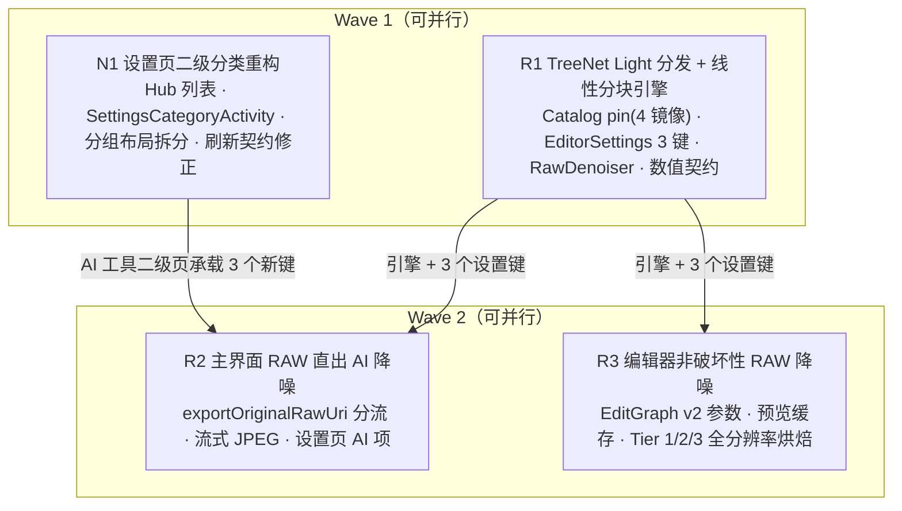

# PhotoSync 设置页二级分类重构与 RAW AI 降噪规范

- **状态**：待实现（仅锁定规格，不含任何源码变更）
- **日期**：2026-11-29
- **代号**：`W-NAV`（设置页二级导航）、`W-DN`（RAW AI 降噪）
- **上位规范**：
  - [端侧与可选云端 AI 工具（P0–P4）完整技术规范](../ai-tools/spec.md)（非破坏性、零预热、合规与隐私底线不推翻）
  - [AI 工具可用性、任意范围消除与统一设置页规范](../ai-usability/spec.md)（`S1`/`S2` 设置基线、`D1` 分发契约、`E1`/`E2` 消除执行范式）
- **前序工单**：
  - [02-s1 统一设置基底](../ai-usability/issues/02-s1-unified-settings-base-and-entry.md)、[04-s2 设置接线/存储/诊断](../ai-usability/issues/04-s2-settings-wiring-storage-and-diagnostics.md)
  - [01-d1 模型分发与目录护栏](../ai-usability/issues/01-d1-model-distribution-and-catalog-guard.md)
  - [01-p0 ORT 运行时、模型管理与设备档位](../ai-tools/issues/01-p0-ort-runtime-model-manager-and-device-gate.md)、[02 编辑图 v2 与资产库](../ai-tools/issues/02-editgraph-v2-asset-store-and-ai-tab-shell.md)、[06-p2 消除笔刷与修补层](../ai-tools/issues/06-p2-inpaint-migan-brush-and-patch-layer.md)
- **实测证据**：`/tmp/opencode/raw-denoise-bench/REPORT.md`（2026-11-29，本机 x86_64，ORT 1.22.0，CPU 2 线程）、`probe_results.txt`、`bench_final.jsonl`、`matrix2_sizes.log`、`sweep_full.jsonl`、`opt_light.onnx`

> 本文件只做两件事：把设置页从 1522 行单页拆成"一级分类 + 二级详情"，以及把 TreeNet Light ONNX 降噪接入 RAW 直出与编辑器烘焙两条既有导出路径。
> 所有性能/质量数字均来自上表实测报告，标注"推算"的条目只用于相对选型；未标注来源的数值一律视为尚未锁定，必须进 §10 门禁。

---

## 1. Problem Statement

### 1.1 设置页：6 个分类正确，但物理上仍是"一页全塞"

`S1` 把设置归并成 6 个**用户意图分组**（联机与相册、编辑器、AI 工具、云端增强、存储与缓存、关于与诊断），分组建模没有问题；问题全部在**呈现层**：

1. **单页 1522 行**。`app/src/main/res/layout/activity_settings.xml` 实测 1522 行、176 个视图元素（`TextView` 109 / `LinearLayout` 59 / `SwitchCompat` 5 / `ImageButton` 1 / `Button` 1 / `ScrollView` 1）、69 个控件 id、**0 个 `<include>`**。六个卡片纵向平铺在一个 `ScrollView` 里（行区间约：联机 66–229、编辑器 230–449、AI 450–852、云端 853–955、存储 956–1222、关于 1223–1521）。
2. **打开即全盘 I/O**。`onCreate` 里 `SettingsStorageSection.bind()` 末行直接调用 `refresh()`，`refresh()` 在 `Dispatchers.IO` 上跑 `StorageUsageReporter.snapshot()`，一次遍历 **5 个目录**（`MODELS` / `AI_EDITS` / `PREVIEW_CACHE` / `LUTS` / `SKY`）；同一 `onCreate` 里 `SettingsDiagnosticsSection.refresh()` 又同步跑 `renderStaticFacts()`（版本、RAM、GLES、ORT、GPU 回退、网络权限、生效设置共 7 段）并异步拉 `AiModelUsageSnapshot.load()`。用户只想改一个开关，却先触发全盘测量 + 全量诊断。
3. **视图数量触发 Lint 告警**。`app/build/reports/lint-results-debug.txt` 中已有两条本文件告警：
   - `activity_settings.xml:670: Warning: activity_settings.xml has more than 80 views, bad for performance [TooManyViews]`
   - `activity_settings.xml:7: Warning: Possible overdraw: Root element paints background @color/darkroom_bg ... [Overdraw]`
   全项目 warning 68 条、error 0；这两条是**结构问题**，`S2` 之后一直挂着。
4. **刷新契约有缺口**：`SettingsActivity.onResume()` 只重绑 `bindTetherGroup()` 与 `bindAiGroup()`，`bindEditorGroup()` 仅在 `onCreate` 调用一次。从编辑器改完预览分辨率/导出质量/撤销深度再回到设置页，编辑器分组显示的是旧值（真实缺陷，非推测）。

### 1.2 RAW → JPEG：高感噪点没有端侧 AI 线性降噪能力

- 主界面 RAW 直出走的是 `RawWrapper.decodeToBitmap(path)`：LibRaw 解码 → `raw_postprocess.cpp` 的 8-bit 出图，降噪只有传统 YCbCr 通道：
  - `resolveDenoiseConfig(effectiveIso)`：`effectiveIso ≤ 150` 完全不降噪；`≥600` 才有 2 遍色度 + 亮度混合；亮度 `sigmaLuma = clamp(7.5 + 2.2 × log2(iso/600), 7.5, 16.0)`、`lumaMix` 上限 0.68。
  - 这是**空间域邻域滤波**，对 ISO 3200–25600 的彩色噪与暗部提亮后的块状噪声只能"抹平"，无法区分细节与噪声。
- 编辑器侧只有 `DetailOps` 的显示域降噪（`NOISE_REDUCTION` 面板），同样作用在 8-bit sRGB 显示域，且**先出图后降噪**，暗部提亮会放大已经量化过的噪声。
- 结果是：高感 RAW 要么直出噪点多，要么靠滑块糊化细节；两种都不是"端侧 AI 线性降噪"。

### 1.3 侦察核实的仓库事实（必须先纠正的两处过期认知）

1. **`BatchBake` 已在 `2bfa906` 整体移除**。该提交（`refactor(ui): simplify darkroom strip, move compare into strip, add inline spinners and dedicated export progress overlay`）删除了 `app/src/main/java/cn/devcxl/photosync/export/BatchBakeController.kt`（-124）、`BatchBakeProgress.kt`（-70）、`BatchBakeWorker.kt`（-157）与 `BatchBakeProgressTest.kt`（-82），同时移除 `WorkManager` 依赖。全仓库已无 `BatchBake` 代码引用，仅剩文档残留：
   - `docs/adr/0009-tethered-darkroom-presets-and-batch-bake.md` 仍把 `BatchBakeWorker` 等列进影响范围并保留"批量烘焙队列"决策 → **ADR 0009 已过期**；
   - `CONTEXT.md:101` 仍保留 **BatchBake（批量烘焙队列）** 词条 → **词汇表已过期**。
   因此本规范覆盖的导出路径只有两条：**① 主界面 RAW 直出 JPEG；② 编辑器全分辨率单张烘焙（Bake）**。**不重建 `BatchBake`**（见 §13）。
2. **`ai-usability` 规范里的 `TD-3`（"RAW 消除仍需整幅解码"）在本规范继续成立并被放大**：线性解码 24 MP 为 `6000 × 4000 × 8 B = 192,000,000 B ≈ 183 MiB` 的 direct `ByteBuffer`，比既有 `decodeToBitmap` 的 `ARGB_8888`（96 MB）翻倍。这决定了直出路径必须**行带流式编码**，不得再持有一整幅 8-bit 位图（§7.3）。

---

## 2. Verified Facts（2026-11-29 本机实测，x86_64 / ONNX Runtime 1.22.0 / CPU 2 线程）

> 环境：AMD Ryzen 5 3600（6C/12T），`taskset -c 0,3` 固定两个跨 CCX 物理核；`intra_op_num_threads=2`、`inter_op=1`、`ORT_SEQUENTIAL`、**`enable_cpu_mem_arena=false`、`enable_mem_pattern=false`**（与 PhotoSync 生产策略一致）、`graph_optimization_level=ORT_ENABLE_ALL`；`onnx 1.23.2` + `onnxruntime 1.22.0`（与 `onnxruntime-android:1.22.0` 同版本）。
> **桌面数字只用于相对选型与数值契约**；真机 ARM64 的耗时、内存与主观画质是独立门禁（§10）。
> 测试机是带负载的桌面（load average 2.5–4.8），所有时间都有实测波动，报告原文已标注。

### 2.1 镜像与完整性（8/8 探针通过，4 镜像 byte-identical）

| 模型 | 镜像 | HEAD | content-length | accept-ranges | Range 探针 | `x-linked-etag`（= SHA-256） |
|---|---|---|---|---|---|---|
| **light** | 1 `huggingface.co/agriggio` | 200 | **1,510,483** | bytes | **206** `bytes 0-65535/1510483`，65,536 B | `082612f3…c9bf78` ✅ |
| light | 2 `hf-mirror.com/agriggio` | 200 | 1,510,483 | bytes | 206 | 同上 ✅ |
| light | 3 `huggingface.co/AyedaOk` | 200 | 1,510,483 | bytes | 206 | 同上 ✅ |
| light | 4 `hf-mirror.com/AyedaOk` | 200 | 1,510,483 | bytes | 206 | 同上 ✅ |
| **full** | 1 `huggingface.co/agriggio` | 200 | **10,073,980** | bytes | 206 `bytes 0-65535/10073980` | `76a07047…0e34c9` ✅ |
| full | 2 `hf-mirror.com/agriggio` | 200 | 10,073,980 | bytes | 206 | 同上 ✅ |
| full | 3 `huggingface.co/AyedaOk` | 200 | 10,073,980 | bytes | 206 | 同上 ✅ |
| full | 4 `hf-mirror.com/AyedaOk` | 200 | 10,073,980 | bytes | 206 | 同上 ✅ |

全量下载后逐仓库 SHA-256：

```
76a07047a33dba3fa27330cec483b43bb57ecb1c1f10db8d979355ce110e34c9  full_m1..m4.onnx   (10,073,980 B ×4)
082612f3de352af7353cb3de893f8dd876b8cb942c53cf5c5f8ab4ae2cc9bf78  light_m1..m4.onnx  (1,510,483 B ×4)
1684f549fec52812ffacc3020bfd61c5fde610e77460fcc03b2a7003f61e60dd  super_light.onnx   (835,451 B)
```

其他变体（顺带实测，不进 v1 分发）：super-light **835,451 B** / `1684f549…f61e60dd`；heavy **21,863,084 B** / `0074e2f7…fc0129`（仅来自 `x-linked-etag`，未下载）；`AyedaOk` 仓库另有 `rawdenoise-rawforge-deblur-deep-24`（去模糊，非降噪）。

> **验证覆盖的边界（必须如实）**：**4 镜像 byte-identical 的结论只对 light 与 full 成立**（各 4 个独立仓库全量下载后 SHA-256 全命中）。super-light 只做了单源（`AyedaOk`）HEAD + 全量下载校验，重 4 镜像一致性**未测**；heavy 只有 `x-linked-etag` 的哈希，**未下载、未跑图**。因此 v1 的 pin 只能落在 light 上，super-light/heavy 的镜像表属于"未测"，不得写进 `AiModelCatalog`。

**许可证事实（必须如实写法，不得简写成 "MIT"）**：

| 来源 | 声明 | 结论 |
|---|---|---|
| 上游 `rymuelle/RawForge` GitHub 仓库 | GitHub API `spdx_id: MIT` | 代码 + 权重 MIT |
| `AyedaOk/rawlab-models` 的逐模型 `model.json` | `"license": {"spdx":"MIT","status":"publisher-declared"}` | 与上游一致（自声明） |
| `agriggio/smart-onnx-models` HF 卡片 | **Apache-2.0**（仓库级，与同仓 SAM2/Big-LaMa 统一） | **与本模型 MIT 不一致** |

规格写法：`MIT（上游 RawForge），托管仓库 agriggio 卡片为 Apache-2.0，两者声明不一致`。该不一致记入 §11 `TD-6`。

### 2.2 ONNX 图结构与 ORT 1.22.0 兼容性

| 字段 | light | full | super-light |
|---|---|---|---|
| opset（`ai.onnx`） | **18** | 18 | 18 |
| IR version | 8 | 8 | 8 |
| producer | pytorch 2.7.0 | 同 | 同 |
| 节点数 | **805** | 805 | 805 |
| 初始化器 | 198 个，**全部 FLOAT16** | 同 | 同 |
| 参数量 | **656,557**（1,313,114 B） | 4,938,149（9,876,298 B） | 319,085（638,170 B） |
| Conv / DepthToSpace | 55 / 4（blocksize=2） | 55 / 4 | 55 / 4 |
| 输入 | `input` **FP16** `[N,3,H,W]`（H/W 动态）+ `cond` **FP16** `[N,1]` | 同 | 同 |
| 输出 | `output` **FP16** `[N,3,H,W]` | 同 | 同 |
| 自定义 domain | 无（`op_domains = {ai.onnx: 805}`） | 无 | 无 |

- **算子集**：报告 §2.1 记「全部唯一 `op_type` 22 种」，同段枚举 24 个名字（`Add, Cast, Clip, Concat, Constant, ConstantOfShape, Conv, DepthToSpace, Div, Gather, GlobalAveragePool, MatMul, Mod, Mul, Pad, Pow, ReduceMean, Reshape, Shape, Slice, Sqrt, Sub, Transpose, Unsqueeze`），**零自定义算子、无 `Resize`、无 `If/Loop` 子图、无 `com.microsoft` 扩展**。*（"22 vs 24" 的口径差异按报告原样引用，不在规格里替上游改数；R1 工单首次加载时用 `OrtSession.getInputInfo()` 复核并回填该计数，见 `TD-8`。）*
- **opset 上限实测（不是查表）**：opset 18 `LOAD_OK`、21 `LOAD_OK`、22 `LOAD_OK`、**23 `FAIL`**（`model_load_utils.h`）→ ORT 1.22.0 上限 22，模型用 18，**4 个版本余量**。
- **归一化常量从图里读出**：首两个节点 `(input - mean) / std`，`mean = 0.0`、`std = 0.066650390625`（= 1/15.0037）→ **模型期望 [0,1] 的线性值**，App 侧不得再做任何缩放或二次归一化。末三节点 `Mul(std) → Add(mean) → Clip(0.0, 1.0)`。
- **`cond` 只被消费一次**：`/model/0/0/trunk/0/sca/...`（Squeeze-Excitation 式 FiLM 标量注入），**不是逐层注入**。
- **内部补边**：图首 `Shape → Gather(2/3) → Mod(16) → Sub → Pad → Slice`，H、W 各自向上补零到 16 的整数倍，推理后裁回原尺寸。→ 任意尺寸可跑（1×1 亦可），但**非 16 倍数会多一次 `Pad`+`Slice`（约 6–7% 节点时间）并在边缘 16–32 px 内引入额外差异**；240×240 vs 245×245 同内容实测 `max 0.1035 / mean 0.0096`。
- **官方 manifest 与实测互相印证**：`AyedaOk/rawlab-models` 的 `model.json` 声明 `input.kind = linear-rec2020-rgb`、`dtype = float16`、`layout = nchw`、`tileSize = 256`、`tileOverlap = 64`、`conditioning = iso-v1`、`normalization = min(iso,65535)/6400`、`output.kind = linear-rec2020-rgb` —— 与实测图结构完全吻合。
- **CPU EP 不是原生 fp16**：`ORT_ENABLE_ALL` 下优化后图 819 节点、**插入 259 个 `Cast`（全部 `to=FLOAT`）**；`ORT_DISABLE_ALL` 下 882 节点 / 295 个 Cast。即整图被升到 fp32 执行，**激活内存按 fp32 计**，fp16 只省权重存储。Cast 占耗时 **9.8%–24.2%**（light 256 → 24.2%，full 384 → 9.8%）。
- **Full 的瓶颈不是卷积**：`ReduceMean` 占 **47.7%–74.4%**（full 256 74.4%、full 384 47.7%），Conv 仅 13.2%–27.1%；light 256 则是 Conv 30.9% / Cast 24.2% / ReduceMean 23.9%。

### 2.3 CPU 2 线程耗时与峰值 RSS

关键尺寸（3 个独立进程 × 7 次计时，取中位数的中位数；括号内为 ms/MP）：

| 模型 | 256×256 | 320×320 | 384×384 | 448×448 | 512×512 |
|---|---|---|---|---|---|
| **light** | **0.089 s**（1.36） | 0.117 s（1.15） | 0.167 s（1.13） | 0.214 s（**1.06**） | 0.415 s（**1.58**） |
| **full** | 0.629 s（9.59） | 0.358 s（3.50） | 1.341 s（9.09） | 0.734 s（3.66） | 4.711 s（**17.97**） |
| **super-light** | 0.055 s（0.84） | 0.074 s（0.72） | 0.108 s（0.73） | 0.136 s（0.68） | 0.293 s（1.12） |

- light 的 per-pixel 成本近似线性；512² 因行跨度 2048 B 出现 ~50% cache 冲突惩罚。
- **full 是双峰的**：同一尺寸跨会话可差 2.5×（256² 出现过 0.30 s / 0.63 s；384² 出现过 0.72 s / 1.34 s），根源是 `ReduceMean` 纯带宽型、被系统内存压力放大 → **规格里 Full 只能写区间 3.5–9.5 ms/MP**。
- 非 128 倍数（320、448）在该环境更稳更快；512 这类 128 倍数更易掉进慢档。非方形/非 2 幂尺寸表现正常（600×400 light 1.02 ms/MP 是全表最佳）。

峰值 RSS（`VmHWM`；解释器基线 ~70 MB，full 载入后 79 MB）：

| 配置 | VmHWM | 净激活增量 |
|---|---|---|
| light 256×256 | 103 MB | **≈33 MB** |
| light 448×448 | 180 MB | ≈110 MB |
| light 512×512 | 199 MB | ≈129 MB |
| full 256×256 | 203 MB | **≈124 MB** |
| full 384×384 | 300 MB | ≈221 MB |
| full 448×448 | **385 MB** | **≈306 MB** |
| full 512×512 | 371–418 MB | ≈292–339 MB |
| super-light 256×256 | 91 MB | ≈21 MB |
| super-light 448×448 | 140 MB | ≈70 MB |

会话初始化（读盘 + 图优化 + Cast 插入）：light **0.106–0.114 s**、full 0.120–0.131 s、super-light 0.065–0.12 s（桌面；手机预计 3–5×）。开启 arena 后 RSS 下降（full 384：326→271 MB）但**不变快**（1.336→1.450 s）——关 arena 买到的是可预测性。

24 MP 全图推算（6000×4000，overlap 64，步进 `tile-64`）：

| 模型 | tile/overlap | tile 数 | 处理像素倍率 | 单块 | **桌面 2 线程全图** |
|---|---|---|---|---|---|
| light | 256/64 | 31×21 = **651** | 1.78× | 0.089 s | ≈58 s |
| light | 320/64 | 384 | 1.64× | 0.117 s | ≈45 s |
| light | 384/64 | 247 | 1.52× | 0.167 s | ≈41 s |
| **light** | **448/64** | 16×11 = **176** | 1.47× | 0.214 s | **≈38 s** |
| light | 512/64 | 126 | 1.38× | 0.415 s | ≈52 s |
| full | 448/64 | 176 | 1.47× | 0.734 s | **≈2.2 min**（快档 ≈2.7 min） |
| full | 256/64 | 651 | 1.78× | 0.629 s | ≈6.8 min（快档 ≈3.3 min） |
| super-light | 448/64 | 176 | 1.47× | 0.136 s | ≈24 s |
| super-light | 256/64 | 651 | 1.78× | 0.055 s | ≈36 s |

**为什么 v1 默认锁定 TreeNet Light（1.51 MB）而不是 Full：**

1. **分发体量**：1,510,483 B vs 10,073,980 B（6.7×）；`byteSize` 越小，四镜像失败面与断点续传成本越低。
2. **CPU 上 Full 的瓶颈不可控**：`ReduceMean` 占 47.7–74.4%，同一尺寸跨会话 2.5× 双峰，**无法给出稳定 ETA**；而 ETA 是本规范 §10 的验收项、也是编辑器推理条的唯一文案来源。
3. **内存**：tile 448 时 Full 净激活 **≈306 MB** vs Light **≈110 MB**；tile 256 时 124 MB vs 33 MB。移动端上 306 MB 增量会与 GL 纹理、解码缓冲叠加。
4. **高 ISO 下 Light 反而更好**：ISO 25600 合成噪声 PSNR，light **35.49 dB** vs full **30.99 dB**（full 更激进、更易过冲，出现 0 值像素）；ISO 6400 时 37.32 vs 37.64 基本持平。
5. **24 MP 端到端**：light 448 ≈38 s vs full 448 ≈2.2 min、full 384 ≈5.5 min。

→ **Light 在"速度 / 内存 / 高感质量"三点同时胜出，只有极低 ISO 的合成平场 PSNR 略逊（ISO 100：39.58 vs 41.50 dB，而两者在该 ISO 都是负收益、会被门控跳过）**。Full/Heavy 明确不进 v1（§13）。

**448² 作为 Light 甜蜜点的依据**：24 MP 全图中 448/64 是 light 最快档（≈38 s，快于 384 的 ≈41 s、320 的 ≈45 s、256 的 ≈58 s、512 的 ≈52 s），且 RSS 增量 ≈110 MB 低于 512 的 ≈129 MB。448 与 384/256/192 均为 16 的倍数。

### 2.4 四条决定实现的数值发现

**(1) 输出被模型自己硬裁到 `[0, 1]`（高光余量必然丢失）**

| 输入 | light 输出（ISO 6400） |
|---|---|
| −0.20 | 均值 **3.7e-5**，99.85% 像素被裁到 0，局部"洗白"到 0.029 |
| −0.05 | 均值 **+0.011**（负值被"编"成正），max 0.2017 |
| 0.00 | ≈0（max 0.00075） |
| 1.00 | 均值 0.9980，81.5% 像素恰为 1.0，min 0.877 |
| **1.20 / 1.5 / 2.0 / 4.0 / 10.0** | **全部恒等于 1.000000（100% 裁剪）** |

→ 结论：`> 1.0` 的线性高光余量在模型内**不可逆丢失**；`−0.05` 这种小负值会被补成 +0.011，**比直接裁 0 更糟**。因此 §6.4 必须做 `HighlightHeadroomGuard`（保高光）+ 深阴影地板保护（防洗白）+ 送模型前 `clamp(0, ∞)`。

**(2) ISO 拐点与弱门控（必须做门控 + 强度混合）**

合成噪声（泊松 40000 e- 满井 + 高斯 2 e- 读出，三区 0.03/0.18/0.72）：

| ISO | cond | 输入 PSNR | light 输出 | full 输出 |
|---|---|---|---|---|
| 100 | 0.015625 | 51.11 dB | **39.58（−11.5）** | 41.50（−9.6） |
| 800 | 0.125 | 42.06 | **38.71（−3.3）** | 40.84（−1.2） |
| 3200 | 0.5 | 36.00 | 37.64（+1.6） | 39.43（+3.4） |
| 6400 | 1.0 | 32.96 | 37.32（+4.4） | 37.64（+4.7） |
| 12800 | 2.0 | 29.82 | 36.89（+7.1） | 34.88（+5.1） |
| 25600 | 4.0 | 26.65 | **35.49（+8.8）** | 30.99（+4.3） |

- 平均改动量随 cond 单调：light 0.0041 → 0.0071 → 0.0124 → 0.0168 → 0.0236 → 0.0341。
- **拐点在 ISO ≈ 2000–3200**：低于此，"编结构"的损失大于去噪收益；ISO 100 直接掉 11.5 dB。
- `cond ≈ 0` 与 `cond = 0.01` 输出几乎相同 → **低 ISO 没有"关闭"模式，只能由 App 侧跳过推理**；`cond = 100` 直接崩坏（PSNR 24.6 dB）→ **必须夹到 `[0, 10.24]`**（公式上限 65535/6400 = 10.2398）。

**(3) 色域：官方声明 `linear-rec2020-rgb`，实测不敏感但偏差真实存在**

| 指标 | 结果 |
|---|---|
| Rec.2020 输入取值范围 | min 0.0026，max 1.0138；负值 0.000%，>1.0 占 0.001% |
| 直接喂 sRGB 的 PSNR | 36.39 dB |
| sRGB→Rec.2020→模型→sRGB 的 PSNR | **35.63 dB**（差 0.76 dB，非决定性） |
| 两条路径输出差 | mean 0.0030，p99 0.0161，max 0.0526 |
| 彩块通道偏差（相对峰值） | 灰轴 ≤0.4%；强绿 +1.3%/+1.1%；饱和色 ≤1.8% |

→ 模型**不是逐通道独立**（绿块 (0.1,0.5,0.1) 的 R 被抬到 0.1143）。按 manifest 做往返，代价只是两次 3×3 矩阵；不做不会崩，但会留下"已知 1–2% 偏差"。**规格按 Rec.2020 写。**

**(4) 分块与接缝：存在 SE 全局依赖，overlap 64 是可行解**

- **感受野**（冲激响应，light 256²，ISO 6400）：中心 0.0193；±8 px 0.0008/0.0017；±16 px 0.0002/0.0003；±24 px 1.2e-4；±32 px 8e-5；±48 px = 0。阈值半径：1e-3 → **10 px**，1e-4 → **127 px（几乎整个 tile）**。
- **上下文敏感性（决定性实验）**：同一 256² 内容单独推理 vs 作为 512² 一部分推理，`mean|Δ| 0.0042`、`max|Δ| 0.067`（去掉 32 px 边后 0.0040）→ **分块与整图本来就不等价，且不是补边造成的，是 SE 全局统计造成的**。
- **接缝实测**（256 高线性斜坡，两块横向拼接 vs 512×256 单次推理）：

| 重叠 | 方式 | PSNR vs 单次 | mean\|Δ\| | max\|Δ\| |
|---|---|---|---|---|
| 0 | 硬切 | 46.98 dB | 0.0033 | **0.0503** |
| 32 | 羽化 | 47.70 dB | 0.0030 | 0.0293 |
| **64** | 羽化 | **48.45 dB** | **0.0027** | **0.0264** |
| 64 | 硬切 | 48.47 dB | 0.0027 | 0.0300 |

  → overlap 64 相对 0 是 **+1.5 dB 且最大误差减半（0.050 → 0.026）**；羽化与硬切几乎无差别（差 0.02 dB），因为块间差异是**低频平滑的全局统计漂移**，不是突变（接缝列梯度 0.0032–0.0037 < 画面自身最大梯度 0.0084）。
- **边缘伪影只在 ≤2 px**：0.8 平场距边 0/1/2/4/8 px 误差 0.0236 / 0.0146 / 0.0097 / 0.0101 / 0.0094（内部 0.0069）→ overlap 64 对"卷积边缘"绰绰有余，真正的成本是全局统计漂移。
- **细节保留（MTF，振幅 0.02 @ 均值 0.18）**：4 px 周期 0.70（ISO100）/ **0.15（ISO6400）**；8 px 0.97/0.73；16 px **0.83/0.65**（稳定凹陷，与 stride 16 潜空间网格共振）；≥20 px 约 1.00 → 不会糊掉大结构。
- **确定性/ dtype**：同进程重复推理 bitwise 一致（max|Δ| = 0.00000000）；**两个输入都必须是 fp16**（fp32 送 `INVALID_ARGUMENT`）；ORT 1.22 vs 1.32 输出等价（fp32 累加末位差 1 count），1.32 在本机快 ~1.5×。

### 2.5 边界声明（避免把桌面结论当移动端结论）

报告 §7 明确列出**本报告不能得出的结论**，本规范同样不越界：

1. **手机端耗时/内存**：ARM64 的缓存层次、NEON/FP16 支持、线程调度与 x86-64 完全不同 → §10 必须真机实测；
2. **XNNPACK / NNAPI EP**：完全未测；这是唯一可能真正吃到 fp16（或加速 `ReduceMean`）的方向；
3. **真实 RAW 画质**：全部用合成平场/合成噪声/正弦光栅，**没有**与 Lightroom/DxO/ART 的主观对比；ISO 拐点（≈2000–3200）是 PSNR 判据，不代表主观观感；
4. **离线转 fp32 模型的实际收益**：只是从 profile（Cast 占 24.2%）推出的推论，未构造 fp32 版本实测；
5. **满幅 24 MP 的端到端时间**：报告 §3.5 是"tile 数 × 单块中位耗时"的推算，未跑真实 24 MP。

### 2.6 仓库侧同日核对（代码事实，非模型实测）

| 检查 | 结果 |
|---|---|
| `activity_settings.xml` 行数 / 视图 / id / `<include>` | 1522 / 176 / 69 / **0** |
| `SettingsActivity.kt` 行数 | 285 |
| `SettingsActivityTest.kt` | 336 行、10 个 `@Test` |
| lint（app 模块） | warning 68、error 0；含上述 `TooManyViews` 与 `Overdraw` |
| `BatchBake` 代码引用 | 无（仅 `CONTEXT.md:101`、`docs/adr/0009-…`、`.scratch/ai-tools/…` 等 5 处文档残留） |
| `EditorSettings.ALL_KEYS` | 9 个静态键 + `ai_inpaint_tile_ms_` 动态前缀 |
| `AppSettings.ALL_KEYS` | 5 个键（`tether_*`/`display_keep_screen_on`），与 `:editor` 严格互斥（ADR 0010） |
| ORT 依赖 | `onnxruntime-android:1.22.0`（`gradle/libs.versions.toml:23`），与报告版本一致 |
| 模型目录 / 下载器 | `AiModelCatalog`（`MODNET_PORTRAIT`、`MI_GAN_PIPELINE`、只读 `MI_GAN_GENERATOR_LEGACY`）、`AiModelDownloadManager.isInstalled/modelFile/importLocal` |
| 计算台账 | `tools/verify-ai-model-catalog.sh` 的 manifest 解析目前只支持 **`url1..url3`**（`for candidate in "${url1:-}" "${url2:-}" "${url3:-}"`）→ 4 镜像必须扩展 |
| 编辑器工具架构 | `EditorGroup.AI` + `EditorToolSpec` + `EditorControlStyle`；已有 `AI_SUBJECT/AI_ERASE/AI_SKY/AI_CLOUD` |
| 编辑器对比 | 顶栏 press-and-hold compare 已存在（`EditorTopBarBinder`，`compareStatusPill`） |
| 存储统计 | `StorageUsageReporter` 5 个 `StorageCategory`；`AI_EDITS` 与 `PREVIEW_CACHE` 同名目录但根不同（`filesDir/edits` vs `cacheDir/edits`） |
| 字串 | `app` 侧 `strings_settings.xml` 中英各 108 条；`editor` 侧中 226 / 英 218 条 |

---

## 3. Solution 概览与依赖图

四个垂直切片，两个可并行波次：**Wave 1 = N1 + R1**，**Wave 2 = R2 + R3**。R3 只消费 R1 的引擎与设置键，与 R2 无相互依赖，不再构成冗余串行边：



**不改变的既有契约**（本规范全程遵守）：

- **原始 RAW 永不改写**：降噪只作用在内存中的线性缓冲/切片，落盘产物仍是导出 JPEG 或 `EditGraph` 参数；编辑器**不落盘全分辨率线性帧**（24 MP 线性 RGBA16F = 183 MiB，既炸盘也突破 `AiAssetStore.MAX_ASSET_BYTES = 64 MiB`）。
- **模型零预热、按需下载、强校验**：未安装时任何路径都不得阻塞用户动作，也不得后台轮询；安装仍走 `byteSize + SHA-256` 双校验 + 原子改名。
- **单活会话**：所有推理仍经 `OrtSessionManager.withSession`，`activeSessionCount` 恒为 0 或 1，跨工具互斥。
- **`EditGraph` 向后兼容**：`schema` 仍为 2，新字段是**可选纯参数**，v1/v2 旧文档解码后得到中性默认值。
- **`InpaintOverlay` 不被二次平滑**：降噪固定在修补之前执行，`applyToLinearBuffer` 之后不再有任何滤波。
- **不新增运行时依赖**：继续 `onnxruntime-android:1.22.0` 与既有 `HttpURLConnection`/`JpegStreamWriter`。

---

## 4. 领域词汇增量

| 术语 | 定义 | 避免混用 |
|---|---|---|
| **SettingsCategory（设置分类）** | 一级设置页的一行目标，也是二级详情页的渲染单位。取值 `TETHER` / `EDITOR` / `AI` / `STORAGE` / `ABOUT` 五个（`CLOUD` 不在此枚举，一级行直达既有 `CloudSettingsActivity`）。每行只带"图标 + 标题 + 一行只读摘要 + 箭头"，**摘要不得触发磁盘 I/O 或推理**。 | 设置分组、标签页、Tab |
| **RawDenoiseOps（RAW 降噪参数）** | `EditGraph` 里的纯参数组：`enabled`、`strength(0..100)`、`isoOverride(Int?)`、`modelId`。它**不引用任何像素资产**，因此可安全序列化、可复制、可撤销；启用与否不代表结果已计算。 | 降噪图层、AI 降噪结果 |
| **HighlightHeadroomGuard（高光余量保护）** | 逐像素的源域保护权重：`w_hl = 1 - smoothstep(0.92, 1.0, peak)`，`peak = max(r,g,b)`（线性、已乘 `autoBrightGain`）。`peak ≥ 1.0` 时 `w_hl = 0`，使模型无法把 `>1.0` 的高光余量压成 1.0。 | 高光恢复、HDR 合成、色调映射 |
| **AutoHighIsoGate（高感自动门槛）** | 直出侧的分流判据：当模式为 `AUTO_HIGH_ISO` 时，仅当 `effectiveIso ≥ threshold` 才启用 AI 降噪；低于门槛**直接跳过推理**（模型没有"关闭"模式，`cond≈0` 仍会改动 0.0155）。 | ISO 阈值、噪声门限 |
| **RawDenoiseSpec（降噪分块规格）** | 引擎的几何参数三元组 `tile / overlap / step`，只有两档：`STANDARD 448/64/384`、`LOW 256/64/192`。三者与"16 的倍数"约束绑定，保证不触发模型内部补边。 | 分辨率、tileSize 设置 |

---

## 5. N1 — 设置页二级分类重构

### 5.1 目标判定（可量化）

| 指标 | 现状 | 目标 |
|---|---|---|
| `activity_settings.xml` 行数 / 视图数 | 1522 / 176 | 一级页 **≤ 260 行 / ≤ 45 视图**；单组最大页（AI 工具）≤ 460 行 / ≤ 75 视图 |
| lint `TooManyViews` | `activity_settings.xml:670` 命中 | **本文件全部清零**（一级页与 5 个分组布局均 ≤ 80 视图） |
| 打开一级页的磁盘 I/O | 5 目录 `snapshot()` + 模型用途快照 | **0 次**（只读 prefs + 常量） |
| 打开一级页的主线程诊断渲染 | 7 段 `renderStaticFacts()` | **0 段**（诊断搬进"关于与诊断"二级页） |
| 编辑器分组 onResume 刷新 | 缺失 | 详情页 `onResume` 统一刷新自身分组 |

### 5.2 一级页（`SettingsActivity`）规格

布局重写为 `activity_settings.xml`：顶栏（返回 + 标题）不变，内容区是一个 `ScrollView` 内 6 个**同构行**（每行用 `item_settings_category.xml` 复制 6 次，或用同一个 `<include layout="@layout/item_settings_category"/>` 六次），每行 = `ImageView(24dp 图标) + TextView(标题) + TextView(一行摘要) + TextView(settings_chevron)`。

| 一级行 | 图标 | 一行摘要（只读，全部零 I/O） | 目标 |
|---|---|---|---|
| **联机与相册** | 复用现有联机图标 | `自动跳转 · 联机删除 · 常亮`，按开关状态用 `开/关` 前缀（3 个 prefs 布尔） | `SettingsCategoryActivity(TETHER)` |
| **编辑器** | `ic_editor_24` | `2048 px · Q95 · 撤销 50`（3 个 `EditorSettings` 读数） | `SettingsCategoryActivity(EDITOR)` |
| **AI 工具** | 现有 AI 图标 | `档位 自动 · 线程 2 · 闲置 30 s`；启用 RAW 降噪时追加 `RAW 降噪 高感自动 ≥1600 · 70%` | `SettingsCategoryActivity(AI)` |
| **云端增强** | 现有云图标 | `已启用 / 未启用`（`CloudProviderConfigStore.isCloudEnabled()` 只读镜像） | **直达** `CloudSettingsActivity` |
| **存储与缓存** | 现有存储图标 | **固定文案**「进入后统计占用」（不在一级页测量） | `SettingsCategoryActivity(STORAGE)` |
| **关于与诊断** | 现有信息图标 | `v<versionName> · ORT 1.22.0`（`PackageInfo` + 常量） | `SettingsCategoryActivity(ABOUT)` |

规则：

- 一级页 `onCreate` 只做：`setContentView`、6 行点击绑定、`cloudStore` 一次读取；`onResume` 只重算 6 行摘要（全部是 prefs 读 + 常量，**单帧同步完成**）。
- 行摘要**不得**展示"（无数据）"式占位后异步补字——那会重新引入 I/O。存储与诊断的实时数值只在二级页出现。
- 一级页不再持有 `EditorSettings`/`AppSettings` 的写操作，避免"两个页面都能改同一个键"的双真相。

### 5.3 二级页与路由

新增 `SettingsCategoryActivity`（`android:exported="false"`，`configChanges` 不特殊声明），`Intent` 只携带 `EXTRA_CATEGORY = SettingsCategory.name`：

- 按枚举 switch 注入对应分组：
  1. `TETHER` → `settings_group_tether.xml`（`settingsAutoFollowSwitch`、`settingsDeleteOnCameraSwitch`、`settingsKeepScreenOnSwitch`、`settingsLivePresetEnabledSwitch`）
  2. `EDITOR` → `settings_group_editor.xml`（`settingsPreviewResolutionRow/Value`、`settingsExportQualityRow/Value`、`settingsUndoDepthRow/Value`、`settingsLutLibraryRow`）
  3. `AI` → `settings_group_ai.xml`（`settingsAiModelsRow`、`settingsSkyAssetsRow`、`settingsTierOverrideRow/Value`、`settingsIntraThreadsRow/Value`、`settingsIdleReleaseRow/Value`、`settingsInpaintModeRow/Value`、`settingsInpaintBrushRow/Value`、`settingsLivePresetApplyAiSwitch`、**新增 `settingsRawDenoiseModeRow/Value`、`settingsRawDenoiseIsoRow/Value`、`settingsRawDenoiseStrengthRow/Value`**）→ §7.1
  4. `STORAGE` → `settings_group_storage.xml`（5 个分类值 + 5 个清理按钮 + 总计 + 一键清理）
  5. `ABOUT` → `settings_group_about.xml`（版本 / RAM / GLES / ORT / GPU 回退 / 模型用途 + 生效设置汇总）
- **本页布局只有容器**：`activity_settings_category.xml` = 顶栏（返回 + 分类标题）+ `FrameLayout(settingsCategoryContainer)`。运行时用 `LayoutInflater.inflate(R.layout.settings_group_x, container, true)` 注入**恰好一个**分组。
  > 这是对"按枚举渲染独立 `<include>` 分组布局"的落地方式：如果像今天一样把 5 个分组以 `<include>` 全塞进一个页面，视图数会重新回到 176，等于把 `TooManyViews` 从一个文件换到另一个文件。
- **控件 id 全部保留**（`settingsXxx` 前缀原样），因此 `strings_settings.xml` 的 108 条文案、`SettingsControlDialogs`、`SettingsAssetImporter`、`StorageUsageReporter` 的现有断言只需改 binding 类型。
- 云端行**不新增二级页**：`CloudSettingsActivity` 保持独立 Activity（密钥、状态、连接测试同源），一级行只做只读镜像 + 直达。

### 5.4 布局拆分与 binding 收窄

| 新文件 | 内容来源（现 `activity_settings.xml` 行区间） | 生成的 binding |
|---|---|---|
| `activity_settings.xml`（重写） | 顶栏 + 6 行 | `ActivitySettingsBinding`（只剩 `settingsBackButton`、`settingsScrollView`、6 行） |
| `item_settings_category.xml`（新） | — | `ItemSettingsCategoryBinding` ×6 |
| `activity_settings_category.xml`（新） | 顶栏 + 容器 | `ActivitySettingsCategoryBinding` |
| `settings_group_tether.xml` | 66–229 | `SettingsGroupTetherBinding` |
| `settings_group_editor.xml` | 230–449 | `SettingsGroupEditorBinding` |
| `settings_group_ai.xml` | 450–852 | `SettingsGroupAiBinding` |
| `settings_group_storage.xml` | 956–1222 | `SettingsGroupStorageBinding` |
| `settings_group_about.xml` | 1223–1521 | `SettingsGroupAboutBinding` |

随之收窄的两个 section：

- `SettingsStorageSection(activity, binding: SettingsGroupStorageBinding, onLutImportRequested, onSkyImportRequested)`（原签名收 `ActivitySettingsBinding`）；
- `SettingsDiagnosticsSection(activity, binding: SettingsGroupAboutBinding, editorSettings, appSettings)`（同上）。

`lutImportLauncher` / `skyImportLauncher` 从 `SettingsActivity` **迁移到 `SettingsCategoryActivity`**（`registerForActivityResult(OpenDocument())` 注册在 Activity 级，只有 `EDITOR`/`AI` 分类会用到它们；`STORAGE` 分类不使用）。原因：`SettingsActivity` 不再持有任何分组控件，若留在原处会变成"永远不可能被触发的注册"。

新增 `SettingsSection` 接口（`refresh()` + `release()`），5 个 section 各自实现：

| section | 构造依赖 | refresh 行为 | 线程 |
|---|---|---|---|
| `SettingsTetherSection` | `AppSettings` | 重读 4 个布尔并重绘 | 主线程 |
| `SettingsEditorSection` | `EditorSettings` | 重读 3 个数值 | 主线程 |
| `SettingsAiSection` | `EditorSettings` + `AiModelDownloadManager`（只读 `isInstalled`） | 重读 6 个数值 + 3 个新键 + 模型安装状态 | 主线程（`isInstalled` 是文件存在性检查，不读模型） |
| `SettingsStorageSection` | `StorageUsageReporter` / `CubeLutStore` / `SkyCustomAssetStore` | 异步测量 5 目录 | `Dispatchers.IO` |
| `SettingsDiagnosticsSection` | `ActivityManager` / `GlCapabilityRegistry` / `PackageManager` / 模型探测日志 | 静态段 + 异步模型快照 | 静态段主线程、模型段 IO |

### 5.5 生命周期与刷新契约（修正既有缺陷）

- `SettingsCategoryActivity.onResume()` **必须**调用当前 section 的 `refresh()`，包括 `EDITOR`。这是对 `bindEditorGroup()` 缺失的显式修正；`SettingsActivityTest` 需新增一条用例：从外部写入 `editorSettings.previewMaxEdge` 后 `activity.recreate()`（或直接 `onResume` 走一遍），断言 `settingsPreviewResolutionValue` 文本更新。
- 一级页 `onResume()` 只重算摘要，且**不得**因为 `EDITOR` 分类的旧值而展示陈旧摘要——摘要每次现算，不缓存。
- `onDestroy()` 里 `storageSection.release()` 取消自己的 `lifecycleScope` 派生任务（当前依赖 `lifecycleScope` 隐式取消，显式化以免未来改成 `applicationScope` 时泄漏）。
- `STORAGE` 分类的清理动作仍走既有 `confirmClear*` 对话框与 `StorageUsageReporter`，本规范不改删除语义。

### 5.6 测试与文档

- **拆分 `SettingsActivityTest`（336 行 / 10 用例）**：
  - 保留在 `SettingsActivityTest`：6 行渲染与 ellipsis 摘要、云端直达、`STORAGE`/`ABOUT` 行点击后 **不** 在一级页触发测量（用 fake reporter / 断言 `snapshot()` 调用次数为 0）。
  - 迁到 `SettingsCategoryActivityTest`（Robolectric）：5 个分类各自渲染、`EDITOR` 的 `onResume` 重读、`AI` 的 3 个新键（§6.2）、LUT/天空导入 launcher 只在该页注册、`CLOUD` 枚举值被拒绝（防御性 `IllegalArgumentException`）。
- **新增 lint 断言**：`./gradlew lintDebug` 后 `activity_settings.xml` 与 5 个 `settings_group_*.xml` 均不出现 `TooManyViews`。
- **新增 ADR**：`docs/adr/0014-settings-two-level-navigation.md`（记录 5/6 分类划分、`<include>`→运行时注入、LUT/天空 launcher 迁移、binding 收窄、以及在 prefs 之外不动存储的决定）。
- **字串**：`strings_settings.xml` 中英各新增一级标题/摘要/分类标题/新键标签，删除不再使用的旧整页文案（例如 `settings_intro` 若保留则改为一级页顶部说明）。

---

## 6. R1 — TreeNet Light 分发、设置键与线性分块降噪引擎

### 6.1 `AiModelCatalog.RAW_DENOISE_TREENET_LIGHT` 精确 pin

```kotlin
val RAW_DENOISE_TREENET_LIGHT = AiModelSpec(
    id = "treenet-denoise-light",
    version = "1",
    fileName = "treenet_light_v1.onnx",
    mirrorUrls = listOf(
        "https://huggingface.co/agriggio/smart-onnx-models/resolve/main/treenet-light.onnx",
        "https://hf-mirror.com/agriggio/smart-onnx-models/resolve/main/treenet-light.onnx",
        "https://huggingface.co/AyedaOk/rawlab-models/resolve/main/models/rawdenoise-rawforge-shadowweightedl1-light/1.0/model.onnx",
        "https://hf-mirror.com/AyedaOk/rawlab-models/resolve/main/models/rawdenoise-rawforge-shadowweightedl1-light/1.0/model.onnx"
    ),
    byteSize = 1_510_483L,
    sha256 = "082612f3de352af7353cb3de893f8dd876b8cb942c53cf5c5f8ab4ae2cc9bf78",
    license = AiModelLicense(
        name = "MIT",  // 上游 rymuelle/RawForge；agriggio 仓库卡片为 Apache-2.0，见 TD-6
        url = "https://github.com/rymuelle/RawForge/blob/main/LICENSE"
    )
)
```

- 加入 `onDemandModels`（AI 模型设置页可见、可下载、可 SAF 导入）；`supportedModels` 随之包含它。**`variantHint` 保持 `null`**（`InpaintVariant` 与降噪无关，不得复用）。
- 加载期签名断言（不进 `InpaintVariant`）：首次 `withSession` 后校验 `inputNames == ["input","cond"]`、两者 `FLOAT16`、`output` 名字与 dtype；不匹配 → `RawDenoiseFailure.BAD_SIGNATURE`（设置页按既有 `INCOMPATIBLE` 文案呈现），**不进入 tile 循环**。

分发与护栏接线：

| 位置 | 变更 |
|---|---|
| `tools/verify-ai-model-catalog.sh` | manifest 解析从 `url1..url3` 扩展到 **`url1..url4`**（`for candidate in "${url1:-}" "${url2:-}" "${url3:-}" "${url4:-}"`）；新条目四源全部做 HEAD + `Range: bytes=0-65535`，至少一源全量下载比对 size + SHA-256 |
| `AiModelCatalogTest` | 新增 `shouldPinTreenetLight_whenTheRawDenoiseEntryShips`：id/fileName/byteSize/sha256/4 镜像顺序 + `!Http` 断言；与脚本 manifest 的一致性测试随之覆盖新条目 |
| `AiModelSettingsText` | 新增 id → `R.string.ai_models_model_treenet`（"RAW 降噪（TreeNet Light）"）与 `…_desc`（"线性光 RAW 降噪，1.4 MB，按 ISO 条件推理"） |
| `THIRD_PARTY_NOTICES.md` | 新条目：文件、1,510,483 B、SHA-256、上游 `rymuelle/RawForge`（MIT）、"权重由上游发布，本仓库不重新导出"、托管卡片 Apache-2.0 的差异声明、四镜像地址 |
| `docs/research/2026-11-29-raw-denoise-treenet-baseline.md` | 新建：直接引用 `/tmp/opencode/raw-denoise-bench/REPORT.md` 的 §1/§2/§3/§5 数据与复现命令，标注"桌面基线，真机金标另测" |
| `CONTEXT.md` | 新增 §4 四个词条 + 修正 `BatchBake` 过期词条（见 §11 `TD-8`） |

### 6.2 `EditorSettings` 新增 3 个键

| 键 | 类型/范围/默认 | 说明 |
|---|---|---|
| `ai_raw_denoise_export_mode` | enum `RawDenoiseExportMode { OFF, AUTO_HIGH_ISO, ALWAYS }`，默认 **`AUTO_HIGH_ISO`** | 决定主界面直出是否走 AI 路径（§7.2）；编辑器内**不受此键约束**（编辑器开关在 `EditGraph` 里） |
| `ai_raw_denoise_iso_threshold` | enum `RawDenoiseIsoThreshold { ISO_1600(1600), ISO_3200(3200), ISO_6400(6400) }`，默认 **`ISO_1600`** | `AutoHighIsoGate` 的门槛；用枚举而非裸 Int，避免出现 1800 这种无意义中间值 |
| `ai_raw_denoise_strength` | Int `0..100`，默认 **`70`** | 直出与编辑器新参数共同引用的"默认强度"；编辑器首次启用时以它为初值 |

约束与实现细节：

- 三个键必须加入 `EditorSettings.ALL_KEYS`；`AppSettings.ALL_KEYS` 不动，`AppSettingsTest` 现有的"交集为空"断言仍然成立（新增键全部以 `ai_` 前缀，不可能撞上 `tether_*`/`display_*`）。
- 新增实测耗时前缀 `ai_raw_denoise_tile_ms_<tier>`（与 `ai_inpaint_tile_ms_` 分开），`isMeasuredTileMsKey()` 一并覆盖两个前缀。配套测试需同步扩展两处既有断言：`EditorSettingsTest`（`:204-205`，`ALL_KEYS` 不含任何实测键）与 `AppSettingsTest`（`:178-185`，交集为空 + 两个前缀都不与 app 侧冲突）。用途：**ETA 只用本机实测值，不用硬编码常量**（沿用 `ai-usability` §7.5 的做法）。
- `EditorSettingsSnapshot` 增 3 个字段；`SettingsDiagnosticsSection` 的"生效设置汇总"增 3 行（`RAW 降噪：高感自动 ≥1600 · 70%`）。
- 默认值理由必须写进 ADR 0015：门槛 1600 低于实测拐点（≈2000–3200），取 1600 是因为**默认强度只有 70%、且 `AUTO_HIGH_ISO` 在低 ISO 下会被跳过**；真机门禁要专门对比 1600 与 3200 的主观结果，若 1600 在 ISO 1600–2000 上出现"编结构"，把默认改成 3200（无需新 schema）。

### 6.3 引擎数学契约

**分块规格** `RawDenoiseSpec`：

| 档 | tile | overlap | step | 16 倍数 | 24 MP tile 数 | 说明 |
|---|---|---|---|---|---|---|
| `STANDARD`（>4 GiB） | **448** | **64** | **384** | 448/384/64 均为 16× | 16×11 = **176** | §2.3 的 light 最快档 + 内存 ≤110 MB |
| `LOW`（≤4 GiB） | **256** | **64** | **192** | 256/192/64 均为 16× | 31×21 = **651** | 单块激活 ≈33 MB |

- **末列/末行采用回退式定位**：`origin = extent - tile`（而非 `k × step` 越界后缩小 tile），保证除"图像本身 < tile"外每块恒为一个 16 的倍数尺寸，**零动态 padding**、不触发模型内部 `Pad/Slice`（§2.2 的 6–7% 额外节点与 16–32 px 边缘差异）。
- **图像 < tile**：单块，边长向上取 16 的倍数，越界像素用**边缘复制**填充后裁回（理由：零填充会拖低均值、直接扰动 SE 全局统计；这是设计决策，不是实测结论）。
- **tile 网格全局锚定**：原点固定为源坐标 `(0,0)` 起的 `k × step`，任何路径（预览 / 烘焙 Tier1/3 / Tier2 切片）都不得按各自区域原点重新排布（这是 Tier 2 唯一能保住的确定性来源，见 §8.6）。

**色彩空间**：线性 sRGB ↔ 线性 Rec.2020（D65，标准 3×3，行和恒为 1，白点不变）：

```
sRGB → Rec.2020                         Rec.2020 → sRGB
[ 0.6274039  0.3292830  0.0433131 ]    [ 1.6604910 -0.5876411 -0.0728499 ]
[ 0.0690973  0.9195404  0.0113623 ]    [-0.1245505  1.1328999 -0.0083494 ]
[ 0.0163914  0.0880133  0.8955953 ]    [-0.0181508 -0.1005789  1.1187297 ]
```

- 系数由 CIE 1931 基色坐标（sRGB `(0.640,0.330)/(0.300,0.600)/(0.150,0.060)`、Rec.2020 `(0.708,0.292)/(0.170,0.797)/(0.131,0.046)`）与 D65 `(0.3127,0.3290)` 推导（`M = solve(XYZ_2020, XYZ_sRGB)`），**不是抄表**；可用 `numpy` 一行复算。
- 往返精度：float64 矩阵误差 `2.2e-16`；float32 矩阵往返 `4.3e-8`，2 万随机样本逐像素最大误差 `2.4e-7` → **规格约束 `< 1e-5`**，单测用固定种子断言。
- 实现位置：`editor/domain/Rec2020Matrix.kt`（纯函数 + 常量），与 GLSL 无关；**渲染管线（Pass A–D）不改任何 shader**。

**输入编码**（严格 fp16，两个输入都必须是 fp16）：

| 张量 | 形状 | dtype | 内容 |
|---|---|---|---|
| `input` | `[1,3,H,W]`（NCHW，H/W = tile） | FP16（`HalfFloatBits.toBits`） | `linear * autoBrightGain`，先 `clamp(0, +∞)` 再转 Rec.2020，最后 `clamp(0, 1)` |
| `cond` | `[1,1]` | FP16 | `clamp(min(condIso, 65535) / 6400.0, 0.0, 10.24)`；`condIso = isoOverride ?: effectiveIso`（编辑器可用 `isoOverride` 手动纠正；直出恒为 `effectiveIso` = 相机 ISO × `autoBrightGain`，`LinearRawBuffer` 已提供） |
| `output` | `[1,3,H,W]` | FP16 | 线性 Rec.2020，取值被模型裁到 `[0,1]` |

- **为什么用 `effectiveIso`**：`autoBrightGain` 是"把暗部提亮到显示白点"的增益，提亮 1 挡等于等效 ISO 翻倍、噪声也翻倍；用相机 ISO 会低估噪声。`cond` 上限 10.24 来自公式本身（65535/6400 = 10.2398），异常 ISO 字段（0 或负）先夹到 `≥ 50`。
- **不得二次归一化**：模型内置 `mean=0, std=0.066650390625`，App 侧只做上面三步，禁止再减均值/除标准差。

**高光余量保护**（`HighlightHeadroomGuard`）：

```
gain       = clamp(autoBrightGain, 1.0, 4.0)     // 0 / NaN → 1.0
src_g      = src × gain                          // 显示线性域
peak       = max(src_g.r, src_g.g, src_g.b)
w_hl       = 1 - smoothstep(0.92, 1.0, peak)
w_lo       = smoothstep(0.004, 0.02, peak)       // 深阴影地板保护
w          = w_hl × w_lo
den_buf    = (Rec2020→sRGB(model_output)) / gain  // 回到缓冲域
guarded    = w × den_buf + (1 - w) × src
out        = lerp(src, guarded, strength / 100f)
```

| 性质 | 断言 |
|---|---|
| `peak ≥ 1.0` → `w = 0` → `out == src`（**逐像素 bit-exact**，因为 `w × den_buf` 项整项消失） | 单测：构造 `peak ∈ {1.0, 1.2, 4.0}` 的像素，`assertEquals(src, out)` |
| `peak ≤ 0.004` → `w = 0` → 深阴影不被"编"出 0.011–0.029 的洗白（§2.4(1)） | 单测：`−0.05` 输入保持原值 |
| `w` 在 `[0.92,1.0]` 上 C1 连续、单调递减；在 `[0.004,0.02]` 上 C1 连续、单调递增 | 数值导数断言 |
| `strength == 0` → `out == src`（整幅恒等） | 全图逐字节相等 |
| 0.92 / 0.004 两个下界是**设计选择**，锚定在实测伪影幅度（0.011 洗白 / 0.029 局部过白 / 1.0 裁剪） | 写进 ADR 0015 并标注"非实测拐点" |

**重叠融合** `RawDenoiseTileWeight`：与 `InpaintTileWeight` **同一数学不变式**——

- tile 权重 `= r_x × r_y`（双线性积），重叠带内相邻两块 `r` 与 `1-r` 严格求和为 1；四块交汇处积仍是 1（`min(r_x, r_y)` 会到 2，禁止）；
- **图像边界与"末列回退定位"产生的额外重叠**：按实际重叠宽度（不是常量 64）计算 ramp；
- 权重只在 tile 的**归属区**生效（tile 覆盖的像素集即归属区，回退定位的末块与前一块重叠更宽时，两者都参与，权重仍互补）；
- 纯权重函数单独可测（不依赖 ORT），浮点求和误差 `< 1e-6`。

**执行约束**：

- 全部 tile 在**同一个** `OrtSessionManager.withSession { }` 块内串行执行（会话创建一次、`Cast` 图优化一次；块内不得再次 `withSession`）；
- 每个 tile 前后检查协程取消（`ensureActive()`），并回报 `tileIndex / tileCount` 进度（编辑器推理条与主界面导出进度共用 0–100 语义）；
- `OutOfMemoryError` / `OrtException` 由 `withSession` 捕获并关闭会话，返回 `RawDenoiseResult.Failure(reason, cause)`；内存不足时**该次降噪整体放弃**，不重试（降噪是"增强"，不值得为它把进程逼到 OOM）；
- 线程：调用方负责 `withContext(Dispatchers.Default)`；ORT 内部线程数仍取 `OrtSessionRuntimeConfig`（默认 2）。

**结果类型**：

```kotlin
sealed interface RawDenoiseResult {
    data class Success(val buffer: LinearRawBuffer, val tiles: Int, val elapsedMs: Long) : RawDenoiseResult
    data class Failure(val reason: RawDenoiseFailure, val cause: Throwable?) : RawDenoiseResult
}
enum class RawDenoiseFailure { MODEL_MISSING, SESSION_UNAVAILABLE, OUT_OF_MEMORY, CANCELLED, BAD_SIGNATURE }
```

---

## 7. R2 — 主界面 RAW 直出 JPEG 接入 AI 降噪

### 7.1 设置页 AI 项集成

`settings_group_ai.xml` 新增一个子区块「RAW 直出 AI 降噪」（三行 + 一行状态），插在「消除档」之后、「联机预设套用 AI」之前：

| 行 | 控件 id | 交互 | 值文案 |
|---|---|---|---|
| 模式 | `settingsRawDenoiseModeRow` / `…Value` | `SettingsControlDialogs.showChoice`：关闭 / 高感自动 / 始终开启 | 关闭·高感自动·始终开启 |
| 高感门槛 | `settingsRawDenoiseIsoRow` / `…Value` | 仅在模式 = 高感自动时可点（否则 `alpha 0.4` + `isEnabled=false`） | `ISO 1600 / 3200 / 6400` |
| 默认强度 | `settingsRawDenoiseStrengthRow` / `…Value` | `showRange(0..100, step 5)` | `70 %` |
| 状态（只读） | `settingsRawDenoiseModelValue` | 点击 → `AI 模型管理` | `模型未安装（点击下载）` / `已安装 · 校验通过` |

- 一级页 AI 摘要追加一段（仅在模式 ≠ 关闭时）：`RAW 降噪 高感自动 ≥1600 · 70%`。摘要文本由 `SettingsHubRow` 计算，**不读模型文件**（模型状态只在二级页展示）。
- 「关于与诊断」的生效设置汇总增 3 行（模式 / 门槛 / 强度）。
- 云端行不受影响；`STORAGE` 分类的 `MODELS` 占用会自然增长（TreeNet Light 1,510,483 B，无需新分类）。

### 7.2 `MainActivity.exportOriginalRawUri` 分流规则

判据集中在一个纯函数里（可单测，不碰 IO）：

```kotlin
fun decideRawExportDenoise(
    mode: RawDenoiseExportMode,
    strength: Int,
    effectiveIso: Float,                       // 来自线性解码后的 LinearRawBuffer
    threshold: RawDenoiseIsoThreshold,
    modelInstalled: Boolean
): RawExportDenoiseDecision            // DENOISE | LEGACY_INSTALL_HINT | LEGACY_SILENT
```

| 条件 | 结果 |
|---|---|
| `mode == OFF` | `LEGACY_SILENT`（完全走原 8-bit 直出，无提示） |
| `strength == 0` | `LEGACY_SILENT` |
| `!modelInstalled && mode != OFF` | `LEGACY_INSTALL_HINT`：走原 8-bit 直出 + 一次轻提示「AI 降噪模型未安装，已按原方式导出；可在 设置 › AI 工具 › AI 模型管理 下载」 |
| `mode == AUTO_HIGH_ISO && effectiveIso < threshold.iso` | `LEGACY_SILENT`（`AutoHighIsoGate`；§2.4(2) 的负收益区间） |
| `mode == AUTO_HIGH_ISO && effectiveIso ≥ threshold.iso` | `DENOISE` |
| `mode == ALWAYS` | `DENOISE`（ISO 不参与判定） |

**注意执行顺序**：判据里的 `effectiveIso` 只有在线性解码后才存在，而"是否解码"本身不能先问一次 8-bit 解码。因此实现顺序是：**先解码线性 → 读 `effectiveIso` → 判据 → `DENOISE` 则继续，`LEGACY_*` 则丢弃线性缓冲改走旧路径**。代价是一次多余的全分辨率解码（对 `OFF` 模式不可接受）→ 于是增加前置短路：`mode == OFF || strength == 0 || !installed` 时**根本不做线性解码**，只有 `mode != OFF` 且模型已安装才解码（此时 `LEGACY_SILENT` 只会发生在"高感门槛未达"，即一次已付的解码成本，可在后续优化为 ROI/半尺寸，记为 `TD-3`）。

### 7.3 线性导出管线（`DenoiseRawExportPipeline`）

```
decodeToLinearRgba16F(path, 0)            // 全分辨率线性 RGBA16F（24 MP ≈ 183 MiB）
  → RawDenoiser.run(spec, ops)            // §6.3，tile 串行 + 进度 + 取消
  → row-band → CameraDefaultLookMath.renderLinearToSrgb(..., autoBrightGain, 0f, CAMERA_DEFAULT)
  → 8-bit sRGB row strip → JpegStreamWriter(out, w, h, exportJpegQuality).writeStrip(...)
  → EXIF（ExifCopier.applyFromRawMetadata，尺寸取最终输出 w/h）
```

要点：

1. **条带流式，不落整幅 8-bit 位图**：`JpegStreamWriter` 已存在（`libraw` 模块，`writeStrip(rgba, rows, bottomUp=false)`），`gallerySink.save(write = { out -> ... })` 的 `write` lambda 里构造 writer 即可。峰值额外内存 = 线性缓冲 + 条带（默认 512 行 × 宽 × 4 B）。
2. **绕开 `raw_postprocess.cpp` 的二次传统降噪**：因为不走 `decodeToBitmap`，`resolveDenoiseConfig` 不再参与；也不会出现"AI 降噪 + YCbCr 亮度混合"的叠加糊化。
3. **观感与原有直出一致**：`renderLinearToSrgb` 的 `camera_default` 分支（`applyToneCurve` + `applyVibrance` + `encodeSrgb`）就是 `raw_postprocess.cpp` 浏览页管线的 Kotlin 镜像，已由 `CameraDefaultLookMathTest` 与 GLSL 锁死；导出时 `exposureEv = 0`、`baseLook = CAMERA_DEFAULT`，与主界面直出同一白点与同一 S 曲线。
4. **残差风险要写进门禁**：原生管线走 16-bit tone LUT（`std::vector<float> toneLut`），Kotlin 侧是 float 直算，理论上存在 ≤1 级的舍入差；§10 用"同一 RAW 两条路径导出后逐像素 diff ≤ 1 级、p99 = 0"锁死。
5. **失败与取消**：
   - 用户取消 → 抛 `CancellationException`，`MediaStore` 的 `IS_PENDING` 记录一并删除（沿用 `gallerySink` 的既有清理语义）；
   - `OutOfMemoryError` / `OrtException` / 任何 `IOException` → **回落旧 8-bit 直出**（若线性解码已成功但降噪失败，可用同一线性缓冲直接换算，不必二次解码）；
   - 回落仍失败 → 返回 `null`，走既有 `"export failed"` 提示（不新增文案）。
6. **进度与取消 UI**：复用 `2bfa906` 引入的导出进度浮层（非阻塞、带取消按钮）。进度 = 解码 0–10% + 降噪 10–90%（按 tile）+ 编码 90–100%。

### 7.4 线程与并发

- 解码与降噪在 `rawExportDispatcher`（既有）上串行；降噪内部 `withContext(Dispatchers.Default)` 不得嵌套到主线程。
- 与编辑器烘焙共享 `BakeConcurrencyGate.rawBakeMutex`？**不共享**：主界面导出与编辑器烘焙不会同时进行（导出时主界面在前台），强行共享会让"编辑器后台烘焙"阻塞用户主动导出。降噪自身的 ORT 单活会话已保证任何时刻只有一路推理。

---

## 8. R3 — 编辑器非破坏性 RAW AI 降噪

### 8.1 `EditGraph` 新增纯参数组（schema v2 内可选字段）

```kotlin
data class RawDenoiseOps(
    val enabled: Boolean = false,
    val strength: Int = 70,          // 0..100
    val isoOverride: Int? = null,    // null = 用 effectiveIso；否则 50..65535
    val modelId: String = ""         // "" = 目录默认 pin；未知 id 视为未启用
) {
    fun isIdentity(): Boolean = !enabled
}
```

- `EditGraph` 末尾追加 `val rawDenoise: RawDenoiseOps = RawDenoiseOps()`，`schema` 仍为 `2`；旧文档缺字段 → 默认值（与 `subject`/`sky`/`cloudLayer` 的 v1 兼容路径一致）。
- **不落盘线性帧**：`rawDenoise` 只存参数；`AiAssetStore` 不新增资产类型；`MAX_ASSET_BYTES = 64 MiB` 不被触碰。
- `isoOverride` 的用途：同一场景多张（不同 ISO）套同一预设时手动纠正；`null` 时按每张的 `effectiveIso` 自动。

### 8.2 契约接线清单（缺一即出现"改了不生效 / 撤销错乱"）

| 位置 | 变更 | 必须的测试 |
|---|---|---|
| `EditGraph.isIdentity()` | 增 `rawDenoise.isIdentity()` | 中性图 `isIdentity() == true` |
| `EditValidator.sanitize` | `strength.coerceIn(0,100)`；`isoOverride?.coerceIn(50,65535)`；`modelId` 只允许 `""` 或目录内已知 id，否则清空并 `enabled=false` | 恶意/过期 JSON 不得把非法值传进渲染 |
| `EditValidator.carriesAiOps` | 增 `graph.rawDenoise.enabled`（→ 强制 `schema = 2`） | v1 文档 + 启用降噪 → 升级为 2 |
| `EditGraphJsonCodec.encode` | 固定写 `"rawDenoise":{...}`（含中性值），保持编解码对称 | 往返相等 |
| `EditGraphJsonDecoder` | 缺字段 → `RawDenoiseOps()`；`isoOverride` 允许 `null` | 旧文档解码 |
| `PresetGraphMerger.resetToOriginal` | 增 `rawDenoise = RawDenoiseOps()` | 复位后 `isIdentity()` |
| `CopyMask` | 新增 `includeAiRawDenoise: Boolean = false`（**纯参数轴**，默认不携带）；`AXIS_COUNT` 11 → **12**；`apply`/`extract` 走 `pick`；`PRESET_MASK` 保持默认值（不含该轴） | 复制/预设互不污染；12 个勾选框映射正确 |
| `EditorUndoController` | 新增 `EditParameterKey.AI_RAW_DENOISE`（开关/强度/ISO 三个控件共用一把键，连续拖动合并为一步） | 拖动一次 = 撤销一步 |
| `EditorToolCatalog` | 新增 `EditorTool.AI_RAW_DENOISE` + `EditorControlStyle.RAW_DENOISE` + `AiRawDenoiseSpecs`（`isModified = graph.rawDenoise.enabled`，`reset = copy(rawDenoise = RawDenoiseOps())`） | 工具有"已修改"标记 |

默认不携带 `includeAiRawDenoise` 的理由（写进 ADR 0015）：噪声是**帧相关**属性（同一场景不同 ISO 的两张，降噪强度需求不同）；而且跨图携带会让"粘贴一次参数"意外触发一次 176 块的推理。需要时用户显式勾选即可。

### 8.3 编辑器 UI

- 「AI」工具栏新增子工具「RAW 降噪」（`editor_tool_ai_raw_denoise` / `…_modified`），面板 `editor_raw_denoise_panel.xml`：
  - 开关（`rawDenoiseSwitch`）：开 → 直接以 `editorSettings.aiRawDenoiseStrength` 为初值写入 `graph.rawDenoise`；关 → `RawDenoiseOps()`（一次撤销步）。
  - 强度滑杆 `0–100`（步进 5），实时显示 `%`；值变化**不触发重新推理**（§8.4 的缓存混合），只重绘。
  - ISO 微调：`自动（effectiveIso N）` / `手动（picker 50–102400，含常用 100/400/800/1600/3200/6400/12800/25600/51200）`。
  - 底部只读行：`模型：TreeNet Light 1.4 MB · 已安装/未安装`。
- **未装模型**：点开关时先走共享 `AiModelPromptDialog.show(context, spec, onDownload, onImport)`（`internal`，本模块内直接可用）；下载完成后再把 `enabled` 置真。
- **JPEG 照片**：整块面板置灰（`isEnabled=false`，`alpha=0.4`），提示「仅支持 RAW 照片」；`EditGraph` 里若已带 `rawDenoise.enabled`（跨图粘贴而来），渲染端按 `EditorSource.isLinear` 判定为 no-op，**不报错、不弹窗**。
- 长按顶栏「对比」（既有 press-and-hold compare）仍切回 `originalSource`：Before = 未降噪、未修补、未调色的原图；After = 完整链路结果。瞬时切换，不重算。

### 8.4 渲染链路顺序

```
decode ─→ RawDenoise ─→ InpaintOverlay ─→ Pass A ─→ Pass B ─→ Pass C ─→ Pass D
```

- **为什么在 `InpaintOverlay` 之前**：修补补丁是"用户明确要求替换的像素"，必须原样进入 Pass A–D；若降噪在其之后，补丁边缘会被再平滑一次，违背 `ai-usability` §6.3 的"洞外 alpha=0 逐像素不变"承诺（该承诺由 `InpaintTileWeight` 保证，但降噪会破坏它）。
- 该顺序只改**源缓冲**，Pass A–D 的 shader、LUT、纹理管线**零改动**。
- 降噪发生在 `LinearRawBuffer` 上，`autoBrightGain` / `effectiveIso` 元数据原样保留；`downscaledTo(proxyCap)` 在降噪之后执行，保证 proxy 与 full 描述同一批像素（与 `EditorSourceLoader` 现有做法一致，只是把顺序从 decode→downscale 改为 decode→denoise→downscale）。

### 8.5 预览端

- 宿主：`EditorSource.LinearRawSource`（`full` ≤ 2048 长边、`proxy` ≤1024），`EditorSourceLoader.load` 不变；新增 `EditorRawDenoiseCoordinator`（`editor/ui`）在 `EditorSession` 装配阶段接管。
- 流程：
  1. 打开照片 → 立即用**未降噪**的 `LinearRawSource` 出首帧（不得让用户等推理）；
  2. 若 `graph.rawDenoise.enabled` 且源是线性 → 后台跑 `RawDenoiser`（`STANDARD`/`LOW` 按设备档），`AiInferenceBarController` 显示 `RAW 降噪 n/N`；
  3. 成功 → 用降噪后的 buffer 重建 `LinearRawSource` 并重传纹理（`EditorSourceTextures`）；失败/取消 → 保留原源，条上给一次性提示。
- **单帧缓存**（进程内存，随会话释放）：
  - 键 = `(sourcePath, modelId, condIso)`，`condIso = isoOverride ?: effectiveIso`（`cond` 只由它决定，因此它才是"已算过"的判据）；
  - 值 = **`guarded` 缓冲**（`w × den + (1-w) × src`，与 strength 无关）；
  - 命中后 `strength` 变化只做一次 `lerp(src, guarded, s)` + 重传纹理（2048×1365 ≈ 2.8 MP，纯 CPU 一遍，桌面 ~20–40 ms），**不重新推理**；
  - 失效条件：`modelId` / `condIso`（含 `isoOverride`）变化、开关从关到开、换图、`release()`。
- **内存账**（必须写进 UI 文案之外的诊断与门禁）：2048×1365×8 B ≈ 22.4 MB／缓冲，缓存 guarded 后常驻 `src + guarded`（≈45 MB）+ 降噪工作缓冲（tile ≤448²×8 ≈ 1.6 MB）。`OutOfMemoryError` → 预览不降噪、烘焙仍降噪，并记一条 `Timber.e`。
- **ETA**：`ai_raw_denoise_tile_ms_<tier>` 有实测值时按 `tiles × measuredMs` 报秒；无实测值时不报秒，只报 `n/N` 块（沿用 `ai-usability` §7.5 的"不拍脑袋"规则）。

### 8.6 预览缓存与全分辨率烘焙（Tier 1 / 2 / 3）

| 路径 | 位置 | 降噪时机 | 备注 |
|---|---|---|---|
| **预览缓存 JPEG** | `BackgroundPreviewRenderer` → `PreviewCacheWriter.writeLinearPreviewTo` | 线性预览写入前，在 `rawBakeMutex` 内 | 保证"下次打开/联机自动预览"看到的也是降噪后的观感，不出现"缩略图没降噪、进编辑器才变" |
| **Tier 1 `FULL_RESIDENCY`** | `BakeSourceTextures.openRaw`（非 `NATIVE_SLICE` 分支） | `decodeToLinearRgba16F` 之后、`inpaint?.applyToLinearBuffer(linear)` 之前 | 整幅只降噪一次，**无接缝**（与 §6.3 全局 tile 网格一致） |
| **Tier 3 `HALF_SIZE`** | 同上（`maxEdge = min(sourceLongEdge/2, textureEdgeCapPx)`） | 同上 | 半尺寸解码后降噪，输出分辨率按既有 Tier 3 语义 |
| **Tier 2 `NATIVE_SLICE`** | `BakeSourceTextures.uploadSlice` | `image.extractRgba16fSlice` 之后、`inpaint?.applyToLinearBuffer(...)` 之前 | 需要 `SourceSlicePlanner` 的 halo 扩边（下） |
| **Tier 2 超纹理上限回落** | `BakeBandEncoder.bindSource` → `uploadReducedFullFrame` | 在 `uploadReducedFullFrame` 内部对整幅降采样帧做**一次整幅降噪**（结果被缓存复用） | 降采样帧是"整幅"，因此该回落路径反而无接缝；必须降噪，否则同一导出里部分 band 有降噪、部分没有 |

**Tier 2 的 halo 与确定性**（本规范最脆的一处，必须显式约束）：

- `SourceSlicePlanner.plan(..., denoiseHaloPx: Int = 64)`：裁切框在既有 `MARGIN_PX = 4`（双线性安全边距）之上再向外扩 **64 px**；`SourceSliceRequest` 增 `denoiseHaloPx` 字段，`BakeBandEncoder` 只读"halo 之外的核心区"进最终图像（既有 `readPlan`/`scatterBandIntoStrip` 语义不变）。
- 切片内的降噪 **必须**复用 §6.3 的**全局锚定 tile 网格**：tile 原点 = 源坐标 `k × step`，允许边缘 tile 按 `extent - tile` 回退，**不得**以切片原点重新从 0 排布。
- **残余风险（必须写进 ADR 与门禁）**：切片窗口截断会改变 SE 的 `GlobalAveragePool` 统计，实测同内容"单独推理 vs 大图内推理"平均差 `0.0042`、最大 `0.067`；两个相邻 band 在 512 px 处各自得到略有不同的全局增益，理论上是 1/255 量级的低频斑块（报告 §5.5 原话："相邻 tile 的全局增益差 ~0.004 在平滑天空上可能形成 1/255 量级的低频斑块"）。Tier 2 只在"极大裁切 + 切片上传"的设备上出现，因此：
  - §10 真机门禁设一条**专用用例**：平滑天空 RAW（或合成渐变）+ Tier 2 强制路径，band 边界处的列梯度不得高于画面自身最大梯度（沿用报告的判据：接缝列梯度 0.0032–0.0037 < 0.0084）；
  - 若真机出现可见接缝，备选方案（**不在 v1 实现范围**，记 `TD-4`）：整幅 native RGB16 缓冲就地进行一次全幅降噪后再切片（该缓冲本来就在内存里，只是把"每切片一次"改成"每帧一次"）。
- 取消语义：Tier 2 每 tile 检查 `coroutine.isActive`；取消 → 整个 `bake` 失败（不是部分成功），与既有 `BakeExporter` 的"取消即中止"一致。

**烘焙的进度与串行**：全部降噪在 `BakeConcurrencyGate.rawBakeMutex` 内，`BakeExporter.bake(request)` 的进度回调里插入"降噪阶段"（`0–k%`），与既有的"band 渲染进度"拼接成一条 0–100%，不新增 UI 组件。

### 8.7 文档收尾

- `CONTEXT.md`：新增 §4 四个词汇（`SettingsCategory` / `RawDenoiseOps` / `HighlightHeadroomGuard` / `AutoHighIsoGate`）+ `RawDenoiseSpec`；**删除过期的 `BatchBake` 词条**并把 ADR 0009 标注为"部分过期"（批量烘焙一节失效，预设/联机部分仍有效）。
- `docs/adr/0015-raw-ai-denoise-treenet-pipeline.md`：模型选择（Light vs Full 的 §2.3 五条理由）、Rec.2020 往返、headroom 与深阴影双护栏、tile 规格、预览缓存只存 `guarded`、Tier 1/3 整幅 vs Tier 2 切片、以及"不落盘线性帧"的理由（183 MiB vs 64 MiB 资产上限）。
- `README.md` / `README.en.md` / `README.ru.md`：功能列表加一条「RAW AI 降噪（TreeNet Light，可关、按 ISO 自动）」；设置页说明改为"一级分类 + 二级详情"。
- `THIRD_PARTY_NOTICES.md`：见 §6.1。

---

## 9. 降级矩阵增量

| 维度 | STANDARD（>4 GiB） | LOW（≤4 GiB） | 兜底 |
|---|---|---|---|
| 引擎 tile 规格 | `448 / 64 / 384` | `256 / 64 / 192` | 图像 < tile → 单块，边长向上取 16 倍 + 边缘复制填充 |
| 模型 | TreeNet Light pin | 同 | 未安装 → 任何路径都**跳过推理**（直出回落 8-bit + 轻提示；编辑器保留开关但显示"未安装"） |
| 直出（主界面） | 按 §7.2 判据 | 同 | 线性解码/降噪 OOM → 回落 8-bit 直出，不重复解码（复用已解出的线性缓冲） |
| 编辑器预览 | 预览帧（≤2048）整幅降噪 | 同（`LOW` tile 降内存） | 预览 OOM → 仅预览不降噪；烘焙仍降噪 |
| 烘焙 Tier 1 | 整幅线性解码后降噪 | 同 | 解码 OOM → 烘焙失败并提示（既有语义） |
| 烘焙 Tier 3（half-size） | 半尺寸帧降噪 | 同 | 与 Tier 1 同路径 |
| 烘焙 Tier 2（native slice） | 切片 + `denoiseHaloPx = 64` | 同 | 切片超 `2560 px` 上限 → `uploadReducedFullFrame`（整幅降采样帧降噪一次） |
| ORT 线程 / 闲置释放 | 设置值（默认 2 / 30 s） | 设置值（`immediate` 强制） | `onMemoryPressure` 恒定立即释放；`withSession` OOM 自动关会话 |
| 强度 | `0..100`，0 = 恒等 | 同 | 越界 clamp；`NaN` → 默认 70 |
| `cond` | `clamp(min(iso,65535)/6400, 0, 10.24)` | 同 | 非法 ISO（≤0/NaN）→ 夹到 50 |

---

## 10. 验收门禁

### 10.1 自动化（JVM / Robolectric，无设备）

**N1**

- `SettingsActivityTest`：6 行渲染；`STORAGE`/`ABOUT` 行点击后 `StorageUsageReporter.snapshot()` 调用次数 = 0；`CLOUD` 行直达 `CloudSettingsActivity`（Robolectric `shadowOf(activity).nextStartedActivity`）。
- `SettingsCategoryActivityTest`：5 个分类各自只 inflate 一个分组布局（断言 `settingsCategoryContainer.childCount == 1`）；`EDITOR` 的 `onResume` 重读（外部写入 `editorSettings.previewMaxEdge = EDGE_1024` 后 `recreate()`，文案变 `1024 px`）；`CLOUD` 枚举被拒 `IllegalArgumentException`；LUT/天空 launcher 只在该页注册。
- lint：`./gradlew lintDebug` 后本规范涉及的 6 个布局无 `TooManyViews`。

**R1**

- `AiModelCatalogTest`：新 pin 的 id/fileName/1_510_483 B/SHA-256/4 镜像顺序 + 与 `tools/verify-ai-model-catalog.sh` manifest 一致；`url4` 解析生效。
- `EditorSettingsTest`：3 个新键默认值、clamp、`ALL_KEYS` 含新键；`AppSettingsTest` 交集仍为空（含新动态前缀 `ai_raw_denoise_tile_ms_`）。
- `Rec2020MatrixTest`：矩阵行和 = 1；float32 往返逐像素 `< 1e-5`（固定种子 2 万样本）。
- `HighlightHeadroomGuardTest`：`peak ≥ 1.0 → w = 0` 且输出逐字节等于源；`peak ≤ 0.004 → w = 0`；单调性与 C1 数值导数；`strength = 0` 全图恒等。
- `RawDenoiseTileWeightTest`：双 tile 重叠带求和 = 1（浮点误差 < 1e-6）；四 tile 交汇 = 1；图像边界不启用 ramp；"末列回退定位"产生的加宽重叠仍互补。
- `RawDenoisePlanTest`：24 MP → 176（STANDARD）/ 651（LOW）；2048×1365 → 24 / 77；末列 `origin = extent - tile`；所有 tile 边长是 16 的倍数。
- `AutoHighIsoGateTest`：§7.2 六条判据全覆盖（含 `OFF` 不触发解码的前置短路）。
- `RawDenoiserTest`（假 session / fake runner）：tile 数、进度序列单调、每个 tile 前检查取消、OOM 返回 `Failure(OUT_OF_MEMORY)` 且会话被释放、`BAD_SIGNATURE` 在 tile 循环前报错。

**R3**

- `EditGraphV2CodecTest`：`rawDenoise` 往返；缺字段旧文档解码 → 中性；`isoOverride = null` 编码/解码；`EditValidator` clamp 与非法 `modelId` 清理；`carriesAiOps` 触发 schema 2。
- `RawDenoiseOpsIdentityTest`：`isIdentity()` 语义；`PresetGraphMerger.resetToOriginal` 复位。
- `CopyMaskTest` / `CopyMaskAiIsolationTest`：12 轴映射；默认不携带 `rawDenoise`；显式勾选后只带参数、不带资产。
- `EditorUndoControllerTest`：`AI_RAW_DENOISE` 连续三次强度变化合并为 1 步，与相邻工具切换不合并。
- `EditorRawDenoiseCoordinatorTest`：缓存键命中（同图同 ISO 不重跑）、strength 变化只重混不重跑、换图失效、`enabled=false` 立即回到原源。
- `BakeRawDenoiseOrderTest`：`decode → denoise → inpaint` 顺序（用 fake stage 记录调用序）；`InpaintOverlay` 之后不得再有任何滤波调用。
- `SourceSlicePlannerTest`：`denoiseHaloPx = 64` 生效、`exceedsUploadLimit` 判据不变。

### 10.2 真机门禁（Redmi K20 Pro / `raphael`）

**第一轮 = 测量轮（产出基线，不设硬指标）**：记录 `ai_raw_denoise_tile_ms_<tier>`（448² 与 256² 各 5 次中位）、预览 2048 帧总耗时、24 MP 导出总耗时、峰值 RSS（`adb shell dumpsys meminfo <pkg>` 取 `TOTAL PSS` 或 `procstats`）。

**第二轮起 = 回归门禁**（数值来自第一轮，锁进 `docs/research/2026-11-29-raw-denoise-treenet-baseline.md`）：

| 用例 | 通过标准 |
|---|---|
| 模型下载 | 四镜像至少 2 条 HTTP 200 + Range 206（桌面实测 4/4 通过，设备侧允许网络劣化）；校验通过；`1,510,483 B`；状态转"已安装" |
| 会话初始化 | ORT 首次加载不崩；记录设备上 `Cast` 是否存在（XNNPACK/NNAPI 未测，`TD-7`）；`withSession` 单活断言 `activeSessionCount ≤ 1` |
| 预览降噪（2048 帧，2.8 MP） | 软目标 ≤ 10 s、硬上限 ≤ 20 s；取消生效 ≤ 500 ms；期间 UI 不 ANR |
| 24 MP 直出（ALWAYS） | 软目标 ≤ 5 min、硬上限 ≤ 10 min；进度按 tile 推进；取消后 `MediaStore` 无残留 pending 记录 |
| 峰值 RSS | 直出 ≤ 400 MB；编辑器预览 ≤ 450 MB（含 GL 纹理）；不得被系统 `lmkd` 杀掉 |
| 高光余量 | 对含 >1.0 高光的 RAW，降噪前后 `peak > 1.0` 区域的缓冲值**逐字节相等**（Bring-up 脚本导出 half-float dump 比对） |
| 平滑天空接缝 | 强 ISO 6400 天空样本，导出图的列梯度 ≤ 画面自身最大梯度（报告判据 0.0032–0.0037 vs 0.0084）；Tier 2 强制路径单独跑一次 |
| 主观画质 | 与现有 8-bit 直出并排：ISO 1600 / 3200 / 6400 各 3 张，噪声下降可辨、细节不糊（16 px 周期凹陷不得肉眼可见为"格子"） |
| JPEG 边界 | JPEG 打开编辑器，RAW 降噪面板置灰、无弹窗；跨图粘贴带 `rawDenoise` 的图到 JPEG 不崩、无视觉变化 |
| 直出观感一致性 | 同一 RAW：旧 8-bit 直出 vs `strength = 0` 的 AI 路径（等价恒等）逐像素 diff ≤ 1 级、p99 = 0 |
| 设置持久化 | 3 个新键重启保留；一级页打开**无**磁盘 I/O（`StrictMode` 检测或 `profiler` 采样） |
| 低端档 | 强制 `tier = LOW`：tile 256 生效、651 块可完成、OOM 回落生效 |

### 10.3 文档与合规

- `THIRD_PARTY_NOTICES.md` 新条目（含 MIT/Apache-2.0 差异声明）；
- `docs/research/2026-11-29-raw-denoise-treenet-baseline.md` 落盘；
- `docs/adr/0014`、`docs/adr/0015` 落盘；ADR 0009 标注部分过期；
- `CONTEXT.md` 词汇增补 + `BatchBake` 词条清理；
- 三语 README 更新。

---

## 11. 决策记录（ADR）与技术债

### 11.1 需写入 ADR 的决策

| # | 决策 | 理由 | 风险与缓解 |
|---|---|---|---|
| 1 | 设置页用"一级分类 + 二级详情"，不做标签页/抽屉 | 5 个分类内容量差异极大（云端 102 行 vs AI 402 行），标签页会把 176 视图塞回同一 Activity；二级 Activity 天然隔离生命周期与 I/O | 多一层导航深度；缓解：一级页摘要足够"自解释"，云端仍直达 |
| 2 | 一级行摘要**永不**展示需要 I/O 的数字（存储占用） | `TooManyViews` 只是表象，真正拖慢首帧的是 5 目录测量；摘要必须零 I/O | 用户看不到"还剩多少空间"；缓解：行副标题写"进入后统计" |
| 3 | 分组布局用**运行时注入**而非 `<include>` 全包含 | 5 个 `<include>` 仍会把 176 视图 inflate 一遍，等于把告警搬家 | 每页一次 `LayoutInflater.inflate`，成本低于一次性全量 |
| 4 | `CLOUD` 不进 `SettingsCategory` 枚举 | 云端密钥/状态/连接测试必须与云页同源，多包一层只会制造双真相（沿用 `ai-usability` §8.3 的迁移结论） | 一级行仍然存在，只是直达 |
| 5 | v1 只分发 TreeNet **Light**（1,510,483 B） | §2.3 五条：体量 6.7×、Full 的 `ReduceMean` 双峰无法给 ETA、RSS +306 MB vs +110 MB、高 ISO 下 Light 反而更好、24 MP 38 s vs 2.2 min | 极低 ISO 合成平场 PSNR 略逊（39.58 vs 41.50 dB），但该区间被 `AutoHighIsoGate` 跳过 |
| 6 | 分块规格锁 `448/64/384`（LOW `256/64/192`），末列回退定位 | 24 MP 最快档 + 内存可接受；全部 16 倍数可免去模型内部补边；回退定位保证 tile 尺寸恒定 | 末块与前块重叠可能 > 64，权重按实际宽度算（已进单测） |
| 7 | 按 manifest 做 `sRGB → Rec.2020 → 模型 → sRGB` 往返 | 官方声明 `linear-rec2020-rgb`，实测偏差 1–2%（灰轴 ≤0.4%），代价只是两次 3×3 | 若真机观感出现偏色，可只换矩阵常量（不动管线） |
| 8 | 高光用 `w_hl` 源域保护，而非"先按白点缩放再整体反算" | 缩放会把整幅压暗、改变噪声相对信噪比，且需要用户可调白点（超出范围）；逐像素 guard 只在 `>0.92` 处线性让位，`>1.0` 100% 保留 | 0.92 处有 8% 的高光被"半降噪"；写进 ADR 并进真机观感门禁 |
| 9 | 编辑器不落盘线性帧，只存参数 | 24 MP 线性 RGBA16F = 183 MiB ≫ `MAX_ASSET_BYTES = 64 MiB`；非破坏性要求本来只需参数 | 每次打开都要重算 → 预览缓存 + ETA 承担体验 |
| 10 | 预览缓存只存 `guarded`（与 strength 无关） | 强度是线性混合，缓存住"已降噪"的那一半，拖动滑杆变成一次 O(N) 混合而不是 176 次推理 | 内存 +22 MB/帧；`LOW` 档靠 tile 与 OOM 回退兜住 |
| 11 | 降噪固定在修补之前 | 修补补丁是用户显式替换的像素，不能二次平滑（`ai-usability` §6.3 的 alpha 不变量） | Tier 2 的 `uploadSlice` 也是"extract → denoise → inpaint"顺序，已进单测 |
| 12 | 直出默认 `AUTO_HIGH_ISO` + 门槛 1600 + 强度 70 | 实测拐点 ≈2000–3200，低于此是负收益；默认强度只 70% 已在混合里留了余量 | 1600–2000 区间主观结果待真机确认；若出现"编结构"改默认 3200（无 schema 变更） |

ADR 文件：

- `docs/adr/0014-settings-two-level-navigation.md` — 决策 1–4 + `SettingsCategory` 枚举边界 + binding 收窄 + 刷新契约修正；
- `docs/adr/0015-raw-ai-denoise-treenet-pipeline.md` — 决策 5–12 + 数值契约（矩阵、cond 公式、guard 阈值）+ Tier 2 halo 残余风险。

### 11.2 可追踪技术债

| ID | 内容 | 原因 / 影响 | 移除条件 |
|---|---|---|---|
| `TD-1` | 离线把 Light 权重转 fp32 重导出（Cast 占 24.2% 的推论未实测） | CPU EP 无原生 fp16 kernel，ORT 插入 259 个 Cast | 真机 profile 确认 Cast 占比后单独评估；报告 §7.4 明确"未实测" |
| `TD-2` | Full / Heavy 变体不进 v1 | 见决策 5 | 若真机证明 Light 质量不足，再加 pin（仅新增目录项 + 设置项，不动管线） |
| `TD-3` | 直出仍全分辨率线性解码（24 MP ≈183 MiB）；`autoBrightGain` 已付一次裸解码成本 | 复用 `decodeToLinearRgba16F(path, 0)` 无 ROI 能力（沿用 `ai-usability` TD-3） | 原生侧提供 ROI/条带解码 |
| `TD-4` | Tier 2 切片降噪的全局统计漂移（实测同内容 mean 0.0042 / max 0.067） | SE 的 `GlobalAveragePool` 是全局依赖，overlap 只能覆盖卷积边缘 | 真机接缝门禁不过 → 改为"整幅 native 缓冲就地进行一次降噪后再切片" |
| `TD-5` | 16 px 周期频响凹陷（MTF ISO100 0.83 / ISO6400 0.65，12–20 px 反而 ≈1.0） | 模型最深层 stride 16，与 tile 256 的 16×16 潜空间共振；可测的非线性频响 | 上游模型更新或换 tile 尺寸重测 |
| `TD-6` | 许可声明冲突：上游 MIT vs `agriggio` 卡片 Apache-2.0 | 同仓库混放 SAM2/Big-LaMa 的统一仓库级声明 | 上游/托管统一，或改用 `AyedaOk` 为唯一首选源 |
| `TD-7` | x86 与 ARM64 的性能/EP 差异未测；XNNPACK 是否吃 fp16 未知 | 桌面 AVX2 + 独立 L3，ARM64 完全不同（报告 §7.1/§7.2） | §10.2 测量轮落盘后再谈优化 |
| `TD-8` | 文档过期：`docs/adr/0009` 的批量烘焙一节、`CONTEXT.md:101` 的 `BatchBake` 词条；报告 §2.1 的"22 vs 24 算子"口径 | `2bfa906` 删除 `BatchBake` 但文档没跟；算子计数是上游报告内部不一致 | 本规范 §8.7 清理文档；算子计数在 R1 首次加载复核后回填 |

---

## 12. 工单拆分与依赖

| 工单 | 内容 | 依赖 | 预估 |
|---|---|---|---|
| **N1** 设置页二级分类重构 | 一级 6 行 Hub、`SettingsCategoryActivity`、5 个分组布局拆分、binding 收窄、launcher 迁移、`onResume` 刷新契约修正、测试拆分、ADR 0014 | 无（可与 R1 并行） | 3 天 |
| **R1** TreeNet Light 分发 + 引擎 | Catalog pin（4 镜像）、`verify-ai-model-catalog.sh` 扩到 `url4`、`AiModelCatalogTest`、`AiModelSettingsText` + 字串、`THIRD_PARTY_NOTICES`、研究文档、`EditorSettings` 3 键 + 快照 + 诊断行、`RawDenoiseSpec/Rec2020Matrix/HighlightHeadroomGuard/RawDenoiseTileWeight/RawDenoiser`、单测全套 | 无（模型分发可先合） | 4 天 |
| **R2** 主界面 RAW 直出 AI 降噪 | `decideRawExportDenoise`、`DenoiseRawExportPipeline`（线性解码 → 降噪 → 行带 → `JpegStreamWriter` → EXIF）、进度/取消/回落、设置页 AI 三行 + 一级摘要 + 诊断汇总 | R1（引擎 + 3 键）；N1（AI 二级页宿主） | 2.5 天 |
| **R3** 编辑器非破坏性降噪 | `RawDenoiseOps` + 全套契约接线（`isIdentity`/validator/codec/`resetToOriginal`/`CopyMask` 12 轴/undo key/tool spec + panel）、`EditorRawDenoiseCoordinator` + 单帧缓存、预览缓存、烘焙 Tier 1/2/3、`SourceSlicePlanner` halo、ADR 0015、CONTEXT/README | R1 | 5 天 |

关键路径：**R1 → R3（约 9 天）**。Wave 1 内 N1（3 天）与 R1（4 天）并行，Wave 2 内 R2（2.5 天）与 R3（5 天）并行，总计约 **9 天 / 14.5 人日**。

拆分建议：`R1` 的"Catalog pin + 设置键 + 分发护栏"可单独先合（约 1.5 天），此时用户已能在设置页看到并下载模型，但**没有任何导出路径消费它**——这不构成用户可见功能，符合"零预热"红线（未安装时任何路径都跳过）。

---

## 13. Out of Scope

- **`treenet.onnx`（Full，10,073,980 B）与 `treenet-heavy.onnx`（21,863,084 B）变体**：不分发、不出现在 AI 模型页、不做设置项（`TD-2`）。
- **JPEG 通用盲降噪**：模型要线性 Rec.2020 + ISO 条件，8-bit sRGB JPEG 喂进去是错误域；编辑器的显示域降噪仍由 `DetailOps` 承担。
- **重建 `BatchBake`**：`2bfa906` 已整体移除（`WorkManager` 依赖同时删除）；本规范只覆盖"主界面单张直出"与"编辑器单张全分辨率烘焙"，多选批量导出不在范围。
- **离线把模型转 fp32 重导出**：只作为 `TD-1` 记录，不在本规范里构造新产物（报告未实测其收益）。
- **ROI / 条带线性解码**：`TD-3`；直出仍整幅解码。
- **模型并行推理**（多 tile 并发）：沿用"单活会话 + 串行 tile"的唯一安全形态。
- **新增模型（天空/主体/消除）的任何行为变化**：本规范不改 `MODNET`/`MI_GAN` 的 pin、变体探测或交互。
- **云端默认行为变化**（仍默认关闭、纯 BYOK）。
- **白点/曝光的手动重映射**（"先按白点缩放再降噪"的替代方案）：只保留逐像素 `HighlightHeadroomGuard`。
