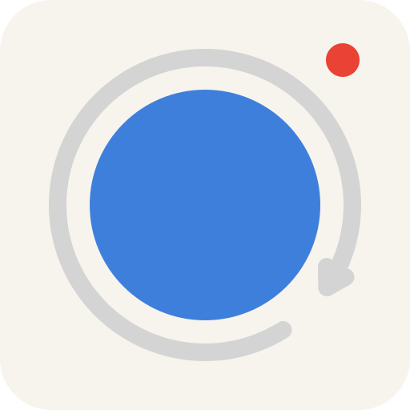

<div align="center">
  
</div>

<h1 align="center">PhotoSync</h1>

<div align="center">


[中文版本](./README.md) · [Русская версия](./README.ru.md) · [Latest release](https://github.com/devcxl/PhotoSync/releases)

</div>

---

PhotoSync is an Android camera companion app for photographers and imaging enthusiasts. Connect your camera over a single USB cable to auto-transfer on capture, browse and preview, **grade and retouch on location**, and export or delete RAW/JPEG photos on your phone or tablet.

## Features

**Tethering and gallery**
- **USB PTP direct connection** — attach the camera with a single USB cable and tap connect
- **Auto-transfer on capture** — photos arrive as you shoot, ready to review
- **Smooth browsing** — thumbnail-first loading, tiled JPEG rendering, pinch zoom and pan
- **Remembers your place** — reopening the app returns to the last photo you viewed
- **Photo management** — delete photos from local storage

**Non-destructive editor**
- **Tone** — exposure, brightness, contrast, highlights/shadows/whites/blacks, glow
- **White balance and color** — D65 Bradford temperature/tint, saturation, vibrance, 8-band HSL, split toning, fade
- **Curves** — RGB and per-channel
- **Detail and effects** — clarity, texture, dehaze, sharpen, noise reduction, 3D LUT (.cube), grain, vignette, lateral CA/defringe
- **Geometry** — crop, rotate/flip, perspective, liquify brush with persisted displacement grids
- **RAW** — 16-bit linear decode with Base Look (Camera Default / Linear Neutral), preserving highlight headroom

**Portrait**
- **Skin** — smoothing and even tone (MediaPipe segmentation)
- **Face reshape** — face, eyes, nose, chin, forehead, smile (MLS mesh)
- **Body reshape** — waist and legs with draggable guide lines

**AI tools (on-device, downloaded on demand)**
- **Subject cut-out** — MODNet mask + banded GuidedFilter + FMGE decontamination; transparent PNG (alpha preserved), solid backdrop and background bokeh
- **Independent foreground/background grading** — separate exposure, temperature and saturation offsets
- **Smart erase** — MI-GAN repair for any painted area: source-pixel brush (8–1200 px with small/medium/large presets), fine/fast modes, and progressive batch commits you can stop while keeping finished work
- **Sky replacement** — model-free classic sky segmentation, four 0 KB procedural skies, optional CC0 cloud pack (not bundled) and OKLab foreground relighting
- **On-demand model manager** — MODNet and MI-GAN never ship in the APK; the "AI models" page downloads from ordered mirrors or imports a local `.onnx`, verified by exact byte size and SHA-256
- **Optional cloud enhancement (off by default)** — pure BYOK OpenAI-compatible / Gemini / self-hosted ComfyUI; HTTPS only, redirects disabled, every EXIF tag and embedded thumbnail stripped before upload

**Settings and diagnostics**
- **Unified settings page** — one gear entry with six groups: tethering and gallery, editor, AI tools, cloud enhancement, storage and cache, about and diagnostics
- **Storage and diagnostics** — per-category usage and cleanup for models, AI edit assets, preview cache, LUTs and skies, plus a read-only summary of the effective settings

**Tethered darkroom**
- **User presets** — save/apply a look including portrait work, plus five built-in presets
- **LiveTetherPreset** — new captures automatically receive the active preset
- **Copy/paste between photos** — choose the axes to carry (grade, skin, reshape, geometry, liquify)
- **Batch export** — queue a multi-selection for background export

**RAW and export**
- **RAW decoding** — LibRaw + lcms2, 20+ formats including ARW, CR3, NEF, DNG, RAF
- **Lossless export** — JPEG copied as-is; RAW and edited frames baked at full resolution (libjpeg-turbo for JPEG, streaming RGBA8 PNG for cut-outs, EXIF written back)
- **Local by default** — all image processing happens on device; the optional cloud enhancement is off by default and BYOK-only

## Use Cases

- On-location review without draining the camera battery
- Quickly import RAW/JPEG to a tablet or large screen for review
- On-location finishing: apply a preset, liquify and face/body reshaping before delivery
- On-location delivery: cut out the subject onto a transparent PNG, erase passers-by, replace the sky
- Batch export to local storage, no compression, no cloud upload

## Quick Start

1. Connect the camera to your phone/tablet with a USB cable
2. Set the camera to "PC Connection" or "PTP/MTP" mode
3. Open PhotoSync and tap "Connect camera" — photos sync into the app
4. Open a photo in the editor: grade, curves, portrait, liquify, or use the AI tab for cut-out, erase and sky
5. Save, then export to the system gallery or keep shooting

---

## Tech Stack

| Category | Tech |
|----------|------|
| Language | Kotlin 2.0 / C++ / JNI |
| UI | XML + ViewBinding (ViewPager2 / PhotoView / SubsamplingScaleImageView) |
| Async | Coroutines + Flow |
| Database | Room (v4: photos, edits, presets) |
| Image processing | LibRaw 0.21.4 + lcms2 2.18 (standalone `libraw.so`), libjpeg-turbo 3.2.2 |
| Portrait | MediaPipe Tasks (Face Landmarker + Image Segmenter) |
| On-device AI | ONNX Runtime 1.22.0 (CPU / XNNPACK; models are downloaded on demand and never bundled) |
| Secrets | AndroidKeyStore (AES-256-GCM, used only by the opt-in BYOK cloud enhancement) |
| Rendering | OpenGL ES 3.0 offscreen chain (Pass A–D) |
| Background work | WorkManager (batch export) |
| Architecture | MVVM + Clean Architecture |
| Min version | Android 7.0 (API 24) |

## Supported RAW Formats

Sony (ARW/SR2) · Canon (CR2/CR3) · Nikon (NEF/NRW) · Fujifilm (RAF) · Panasonic (RW2) · Adobe (DNG) · Olympus (ORF) · Samsung (SRW) · Pentax (PEF) · Leica (RWL) · Hasselblad (3FR) · and more

## Project Structure

```
PhotoSync/
├── app/                    # Main app module (gallery, PTP, tethered darkroom)
│   └── src/main/java/cn/devcxl/photosync/
│       ├── activity/       # Activities, connection and darkroom coordinators
│       ├── adapter/        # RecyclerView / ViewPager adapters
│       ├── data/           # Room database, DAO, entities
│       ├── ptp/            # USB PTP protocol, recovery, connection management
│       ├── receiver/       # USB broadcast receivers
│       └── utils/          # Utilities
├── editor/                 # Image editor module (UI, rendering, portrait, AI, export)
│   └── src/main/java/cn/devcxl/photosync/editor/
│       ├── domain/         # EditGraph, presets, liquify, MLS/body warping, AI asset store
│       ├── render/         # GLES Pass A–D, offscreen preview, subject/sky compositing
│       ├── vision/         # MediaPipe portrait analysis + ONNX Runtime AI (MODNet / MI-GAN)
│       ├── cloud/          # Optional BYOK cloud enhancement (off by default)
│       ├── export/         # Full-resolution streaming bake (JPEG / transparent PNG)
│       └── ui/             # Editor screens and panels
├── libraw/                 # Native module (standalone libraw.so + JNI bridge)
│   └── src/main/
│       ├── cpp/            # CMake, JNI, third_party submodules
│       └── java/           # RawWrapper Kotlin wrapper
└── gradle/
    └── libs.versions.toml  # Dependency version management
```

## Build

```bash
# Prerequisites: Android SDK, NDK, CMake 3.22+
# Clone with submodules
git submodule update --init --recursive

# Debug APK
./gradlew assembleDebug

# Release AAB (Google Play)
./gradlew bundleRelease

# Release APKs split per ABI
./gradlew assembleRelease -PenableAbiSplits

# Unit tests and lint
./gradlew testDebugUnitTest lintDebug
```

APK is generated at `app/build/outputs/apk/debug/app-debug.apk`.
Release AAB is at `app/build/outputs/bundle/release/app-release.aab`.

> Release builds need a signing configuration (`KEYSTORE_PATH` / `KEYSTORE_PASSWORD` / `KEY_ALIAS` /
> `KEY_PASSWORD`); CI injects them from repository secrets, while local builds can use
> `local.properties` or environment variables.

## License

Released under the [MIT license](LICENSE). Third-party components (LibRaw, Little CMS,
libjpeg-turbo and others) keep their own licenses; the full notices, source locations and the
LibRaw (LGPL-2.1) replacement instructions live in [THIRD_PARTY_NOTICES.md](THIRD_PARTY_NOTICES.md).
