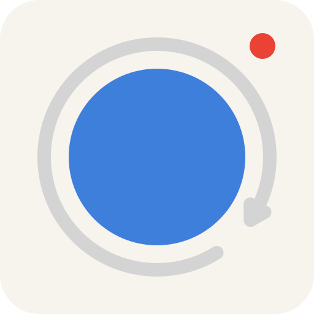

<div align="center">
  
</div>

<h1 align="center">PhotoSync</h1>

<div align="center">


[English version](./README.en.md) · [Русская версия](./README.ru.md) · [下载最新版](https://github.com/devcxl/PhotoSync/releases)

</div>

---

PhotoSync 是一款 Android 相机伴侣应用，专为摄影师和影像爱好者设计。通过 USB PTP 协议直连相机，无需 Wi-Fi、无需电脑客户端，即可在手机/平板上即拍即传、浏览预览、**现场调色与人像修饰**，并导出或删除 RAW / JPEG 照片。

## 功能亮点

**联机同步与相册**
- **USB PTP 直连** — 插入数据线后一键连接相机，无需网络
- **即拍即传** — 相机拍摄后自动传输至本机，实时浏览
- **流畅阅片** — 缩略图优先加载、JPEG 分块渲染、双指缩放与平移
- **记住位置** — 重新打开 App 自动回到上次浏览的照片
- **照片管理** — 支持从本机删除照片

**非破坏性图像编辑器**
- **调色** — 曝光、亮度、对比度、高光/阴影/白场/黑场、发光
- **白平衡与色彩** — D65 Bradford 色温/色调、饱和度、自然饱和度、8 段 HSL、分离色调、褪色
- **曲线** — RGB 与单通道曲线
- **细节与效果** — 清晰度、纹理、去雾、锐化、降噪、3D LUT（.cube）、颗粒、暗角、横向色差/去边
- **几何** — 裁剪、旋转/翻转、透视校正、液化笔刷（位移网格持久化）
- **RAW** — 16-bit 线性解码与 Base Look（Camera Default / Linear Neutral），保留高光宽容度

**人像**
- **皮肤** — 平滑、均匀肤色（MediaPipe 分割）
- **面部重塑** — 脸型、眼睛、鼻子、下巴、额头、笑容（MLS 网格）
- **身体重塑** — 腰部、腿部，可拖拽引导线

**AI 工具（端侧，按需下载）**
- **主体去背** — MODNet 主体蒙版 + 分块 GuidedFilter + FMGE 去色溢；透明 PNG（保留 Alpha）、纯色换底、背景虚化
- **前后景独立调色** — 主体与背景各自的曝光/色温/饱和度偏移
- **智能消除** — MI-GAN-512 涂抹内容感知修复（画笔 + 橡皮，确认后羽化融合）
- **换天空** — 零模型经典天空分割 + 4 组 0 KB 程序化天空 + 可选 CC0 高清云彩包（不内置）+ 前景 OKLab 重光照
- **按需模型管理** — MODNet / MI-GAN 绝不随安装包分发；设置页「AI 模型管理」按多镜像下载或 SAF 导入，严格校验字节数与 SHA-256
- **可选云端增强（默认关闭）** — 纯 BYOK OpenAI-compatible / Gemini / 自建 ComfyUI；强制 HTTPS、禁用重定向、外发前剥离全部 EXIF 与缩略图

**联机暗房**
- **用户预设** — 保存/应用自定义外观（可携带人像调整），内置 5 组精选预设
- **LiveTetherPreset** — 新照片自动套用当前预设
- **跨图复制/粘贴** — 按需选择复制轴（调色 / 皮肤 / 重塑 / 几何 / 液化）
- **批量导出** — 多选照片进入后台导出队列

**RAW 与导出**
- **RAW 解码** — LibRaw + lcms2 色彩管理，支持 ARW、CR3、NEF、DNG、RAF 等 20+ 格式
- **无损导出** — JPEG 直接拷贝；RAW / 编辑图全分辨率流式烘焙（JPEG 走 libjpeg-turbo，去背走流式 RGBA8 PNG，EXIF 写回）
- **默认纯本地** — 图像处理全部在本机完成；可选云端增强默认关闭且为纯 BYOK

## 适用场景

- 外出拍摄时即拍即看，不耗相机屏幕电量
- 现场将 RAW/JPEG 快速导入平板或大屏设备查看
- 现场快修：套用预设调色、液化与面部/身体重塑后再交付
- 现场出片：主体去背导出透明 PNG、涂抹消除路人、换天空后直接交付
- 批量导出照片到本地，无压缩、无云端上传

## 快速上手

1. 用 USB 线将相机连接到手机/平板
2. 在相机上选择「PC 连接」或「PTP/MTP」模式
3. 打开 PhotoSync，点击「连接相机」，照片随即同步到应用
4. 点开照片进入编辑器：调色、曲线、人像、液化，或直接用「AI」Tab 做去背、消除与换天空
5. 保存后回到相册，可导出到系统相册或继续拍摄

---

## 技术栈

| 类别 | 技术 |
|------|------|
| 语言 | Kotlin 2.0 / C++ / JNI |
| UI | XML + ViewBinding（ViewPager2 / PhotoView / SubsamplingScaleImageView） |
| 异步 | Coroutines + Flow |
| 数据库 | Room（v4：照片、编辑记录、预设） |
| 图像处理 | LibRaw 0.21.4 + lcms2 2.18（独立 `libraw.so`）、libjpeg-turbo 3.2.2 |
| 人像 | MediaPipe Tasks（Face Landmarker + Image Segmenter） |
| 端侧 AI | ONNX Runtime 1.22.0（CPU / XNNPACK；模型 100% 按需下载，不随包内置） |
| 密钥存储 | AndroidKeyStore（AES-256-GCM，仅按需的 BYOK 云端增强） |
| 渲染 | OpenGL ES 3.0 离屏渲染链（Pass A–D） |
| 后台任务 | WorkManager（批量导出） |
| 架构 | MVVM + Clean Architecture |
| 最低版本 | Android 7.0（API 24） |

## 支持的 RAW 格式

Sony (ARW/SR2) · Canon (CR2/CR3) · Nikon (NEF/NRW) · Fujifilm (RAF) · Panasonic (RW2) · Adobe (DNG) · Olympus (ORF) · Samsung (SRW) · Pentax (PEF) · Leica (RWL) · Hasselblad (3FR) · 以及更多

## 项目结构

```
PhotoSync/
├── app/                    # 主应用模块（相册、PTP 连接、联机暗房）
│   └── src/main/java/cn/devcxl/photosync/
│       ├── activity/       # Activity、连接与暗房协调器
│       ├── adapter/        # RecyclerView / ViewPager 适配器
│       ├── data/           # Room 数据库、DAO、Entity
│       ├── ptp/            # USB PTP 协议、恢复与连接管理
│       ├── receiver/       # USB 广播接收器
│       └── utils/          # 工具类
├── editor/                 # 图像编辑器模块（UI、渲染、人像、AI、导出）
│   └── src/main/java/cn/devcxl/photosync/editor/
│       ├── domain/         # EditGraph、预设、液化、MLS/身体重塑、AI 资产存储
│       ├── render/         # GLES Pass A–D、离屏预览、主体/天空合成
│       ├── vision/         # MediaPipe 人像分析 + ONNX Runtime 端侧 AI（MODNet / MI-GAN）
│       ├── cloud/          # 可选 BYOK 云端增强（默认关闭）
│       ├── export/         # 全分辨率流式烘焙（JPEG / 透明 PNG）
│       └── ui/             # 编辑器界面与面板
├── libraw/                 # Native 模块（独立 libraw.so + JNI 桥接）
│   └── src/main/
│       ├── cpp/            # CMake、JNI、third_party 子模块
│       └── java/           # RawWrapper Kotlin 封装
└── gradle/
    └── libs.versions.toml  # 依赖版本管理
```

## 构建

```bash
# 前置条件：Android SDK、NDK、CMake 3.22+
# 首次克隆需初始化子模块
git submodule update --init --recursive

# Debug APK
./gradlew assembleDebug

# Release AAB（Google Play）
./gradlew bundleRelease

# 按 ABI 拆分的 Release APK
./gradlew assembleRelease -PenableAbiSplits

# 运行单元测试并检查 Lint
./gradlew testDebugUnitTest lintDebug
```

生成的 Debug APK 位于 `app/build/outputs/apk/debug/app-debug.apk`。
Release AAB 位于 `app/build/outputs/bundle/release/app-release.aab`。

> Release 构建需要签名配置（`KEYSTORE_PATH` / `KEYSTORE_PASSWORD` / `KEY_ALIAS` / `KEY_PASSWORD`），
> CI 从仓库 Secrets 注入；本地可使用 `local.properties` 或环境变量。

## License

本项目以 [MIT](LICENSE) 许可发布。第三方组件（LibRaw、Little CMS、libjpeg-turbo 等）遵循
各自的许可，完整的版权声明、源码位置与 LibRaw（LGPL-2.1）替换说明见
[THIRD_PARTY_NOTICES.md](THIRD_PARTY_NOTICES.md)。
