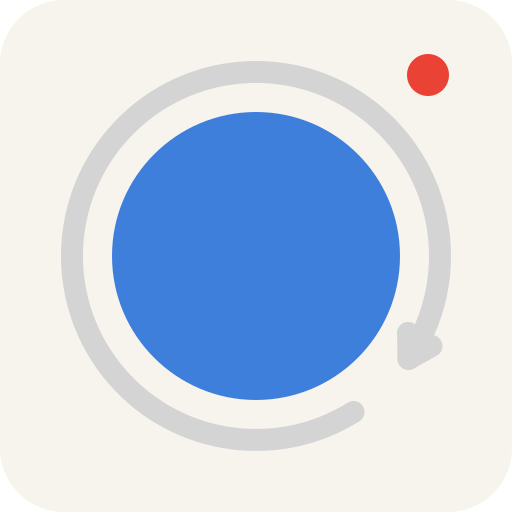

<div align="center">
  
</div>

<h1 align="center">PhotoSync</h1>

<div align="center">


[中文版本](./README.md) · [English version](./README.en.md) · [Последний релиз](https://github.com/devcxl/PhotoSync/releases)

</div>

---

PhotoSync — Android-приложение-компаньон для камеры, созданное для фотографов и энтузиастов обработки изображений. Подключите камеру напрямую через USB PTP — без Wi-Fi и без настольного ПО — чтобы автоматически передавать снимки, просматривать их, **обрабатывать на месте**, а также экспортировать или удалять RAW/JPEG прямо на телефоне или планшете.

## Возможности

**Тетеринг и галерея**
- **Прямое USB PTP-подключение** — подключите кабель и нажмите «Подключить», сеть не нужна
- **Авто-передача при съёмке** — снимки передаются на устройство по мере съёмки
- **Плавный просмотр** — миниатюры в первую очередь, плиточная отрисовка JPEG, масштабирование двумя пальцами
- **Запоминает место** — при повторном открытии приложение возвращается к последней просмотренной фотографии
- **Управление фото** — удаление фотографий из локального хранилища

**Неразрушающий редактор**
- **Тон** — экспозиция, яркость, контраст, светлые/тёмные/белые/чёрные точки, свечение
- **Баланс белого и цвет** — температура/оттенок по D65 Bradford, насыщенность, вибранс, 8-полосный HSL, раздельное тонирование, выцветание
- **Кривые** — RGB и поканальные
- **Детали и эффекты** — чёткость, текстура, дехайз, резкость, шумоподавление, 3D LUT (.cube), зерно, виньетка, хроматическая аберрация/дефриндж
- **Геометрия** — кадрирование, поворот/отражение, перспектива, кисть «ожижение» с сохраняемой сеткой смещений
- **RAW** — 16-битное линейное декодирование с Base Look (Camera Default / Linear Neutral)

**Портрет**
- **Кожа** — сглаживание и выравнивание тона (сегментация MediaPipe)
- **Форма лица** — лицо, глаза, нос, подбородок, лоб, улыбка (MLS-сетка)
- **Форма тела** — талия и ноги с перетаскиваемыми направляющими

**ИИ-инструменты (на устройстве, модели загружаются по требованию)**
- **Вырезание объекта** — маска MODNet + полосный GuidedFilter + FMGE; прозрачный PNG (альфа сохраняется), однотонный фон и размытие фона
- **Раздельная коррекция объекта и фона** — независимые экспозиция, температура и насыщенность
- **Умное удаление** — восстановление MI-GAN для любой области: кисть в пикселях исходника (8–1200 px, пресеты «малый/средний/большой»), режимы «точно/быстро» и поэтапная пакетная фиксация с возможностью остановки без потери готового
- **Замена неба** — классическая сегментация неба без модели, четыре 0 КБ процедурных неба, опциональный CC0-пакет облаков (не входит в сборку) и OKLab-пересвет переднего плана
- **Менеджер моделей по требованию** — MODNet и MI-GAN не входят в APK; страница «ИИ-модели» загружает их из упорядоченных зеркал или импортирует локальный `.onnx` с проверкой точного размера и SHA-256
- **Опциональное облачное усиление (по умолчанию выключено)** — только BYOK: OpenAI-совместимые сервисы, Gemini и собственный ComfyUI; только HTTPS, редиректы запрещены, перед отправкой удаляются все EXIF и встроенная миниатюра

**Настройки и диагностика**
- **Единая страница настроек** — одна шестерёнка и шесть групп: тетеринг и галерея, редактор, ИИ-инструменты, облачное усиление, хранилище и кеш, о приложении и диагностика
- **Хранилище и диагностика** — занятость и очистка по категориям (модели, ИИ-ассеты, кеш превью, LUT, небо) и сводка действующих настроек

**Тетеринговая «тёмная комната»**
- **Пользовательские пресеты** — сохраняйте и применяйте обработку, включая портретные правки; пять встроенных пресетов
- **LiveTetherPreset** — новые снимки автоматически получают активный пресет
- **Копирование между фото** — выбор осей (тон, кожа, форма, геометрия, ожижение)
- **Пакетный экспорт** — очередь экспорта для нескольких выбранных фото

**RAW и экспорт**
- **Декодирование RAW** — LibRaw + lcms2, 20+ форматов: ARW, CR3, NEF, DNG, RAF и др.
- **Экспорт без потерь** — JPEG копируется как есть; RAW и обработанные кадры рендерятся в полном разрешении (libjpeg-turbo для JPEG, потоковый RGBA8 PNG для вырезанных объектов, запись EXIF)
- **Локально по умолчанию** — вся обработка изображений выполняется на устройстве; опциональное облачное усиление по умолчанию выключено и работает только по BYOK

## Сценарии использования

- Просмотр на месте без разряда батареи камеры
- Быстрый импорт RAW/JPEG на планшет или большой экран
- Обработка на месте: пресет, ожижение, изменение формы лица и тела перед сдачей
- Выдача на месте: вырезание объекта в прозрачный PNG, удаление прохожих, замена неба
- Пакетный экспорт в локальное хранилище — без сжатия и облака

## Быстрый старт

1. Подключите камеру к телефону или планшету через USB-кабель
2. На камере выберите режим «PC Connection» или «PTP/MTP»
3. Откройте PhotoSync и нажмите «Подключить камеру» — снимки появятся в приложении
4. Откройте фото в редакторе: тон, кривые, портрет, ожижение или вкладка «ИИ» для вырезания, удаления и неба
5. Сохраните и экспортируйте в системную галерею либо продолжайте съёмку

---

## Технологический стек

| Категория | Технология |
|-----------|------------|
| Язык | Kotlin 2.0 / C++ / JNI |
| UI | XML + ViewBinding (ViewPager2 / PhotoView / SubsamplingScaleImageView) |
| Асинхронность | Coroutines + Flow |
| База данных | Room (v4: фото, правки, пресеты) |
| Обработка изображений | LibRaw 0.21.4 + lcms2 2.18 (отдельная `libraw.so`), libjpeg-turbo 3.2.2 |
| Портрет | MediaPipe Tasks (Face Landmarker + Image Segmenter) |
| ИИ на устройстве | ONNX Runtime 1.22.0 (CPU / XNNPACK; модели загружаются по требованию и не входят в сборку) |
| Секреты | AndroidKeyStore (AES-256-GCM, только для опционального BYOK-облака) |
| Рендеринг | OpenGL ES 3.0, офскрин-цепочка Pass A–D |
| Фоновые задачи | WorkManager (пакетный экспорт) |
| Архитектура | MVVM + Clean Architecture |
| Мин. версия | Android 7.0 (API 24) |

## Поддерживаемые форматы RAW

Sony (ARW/SR2) · Canon (CR2/CR3) · Nikon (NEF/NRW) · Fujifilm (RAF) · Panasonic (RW2) · Adobe (DNG) · Olympus (ORF) · Samsung (SRW) · Pentax (PEF) · Leica (RWL) · Hasselblad (3FR) · и другие

## Структура проекта

```
PhotoSync/
├── app/                    # Основной модуль (галерея, PTP, тетеринговая «тёмная комната»)
│   └── src/main/java/cn/devcxl/photosync/
│       ├── activity/       # Activity, координаторы подключения и «тёмной комнаты»
│       ├── adapter/        # RecyclerView / ViewPager адаптеры
│       ├── data/           # Room база данных, DAO, Entity
│       ├── ptp/            # Протокол USB PTP, восстановление, управление подключением
│       ├── receiver/       # USB широковещательные приёмники
│       └── utils/          # Утилиты
├── editor/                 # Модуль редактора (UI, рендеринг, портрет, ИИ, экспорт)
│   └── src/main/java/cn/devcxl/photosync/editor/
│       ├── domain/         # EditGraph, пресеты, ожижение, MLS/форма тела, хранилище ИИ-ассетов
│       ├── render/         # GLES Pass A–D, офскрин-превью, композитинг объекта и неба
│       ├── vision/         # Портретный анализ MediaPipe + ONNX Runtime (MODNet / MI-GAN)
│       ├── cloud/          # Опциональное BYOK-облако (по умолчанию выключено)
│       ├── export/         # Потоковый экспорт в полном разрешении (JPEG / прозрачный PNG)
│       └── ui/             # Экраны и панели редактора
├── libraw/                 # Нативный модуль (отдельная libraw.so + JNI мост)
│   └── src/main/
│       ├── cpp/            # CMake, JNI, подмодули third_party
│       └── java/           # Kotlin-обёртка RawWrapper
└── gradle/
    └── libs.versions.toml  # Управление версиями зависимостей
```

## Сборка

```bash
# Требования: Android SDK, NDK, CMake 3.22+
# Клонирование с подмодулями
git submodule update --init --recursive

# Debug APK
./gradlew assembleDebug

# Release AAB (Google Play)
./gradlew bundleRelease

# Release APK с разбивкой по ABI
./gradlew assembleRelease -PenableAbiSplits

# Юнит-тесты и линтер
./gradlew testDebugUnitTest lintDebug
```

APK генерируется в `app/build/outputs/apk/debug/app-debug.apk`.
Release AAB находится в `app/build/outputs/bundle/release/app-release.aab`.

> Для release-сборки нужна подпись (`KEYSTORE_PATH` / `KEYSTORE_PASSWORD` / `KEY_ALIAS` /
> `KEY_PASSWORD`); CI берёт их из секретов репозитория, локально можно использовать
> `local.properties` или переменные окружения.

## Лицензия

Проект распространяется по [лицензии MIT](LICENSE). Сторонние компоненты (LibRaw, Little CMS,
libjpeg-turbo и другие) сохраняют свои лицензии; полные уведомления, исходный код и инструкция
по замене LibRaw (LGPL-2.1) находятся в [THIRD_PARTY_NOTICES.md](THIRD_PARTY_NOTICES.md).
